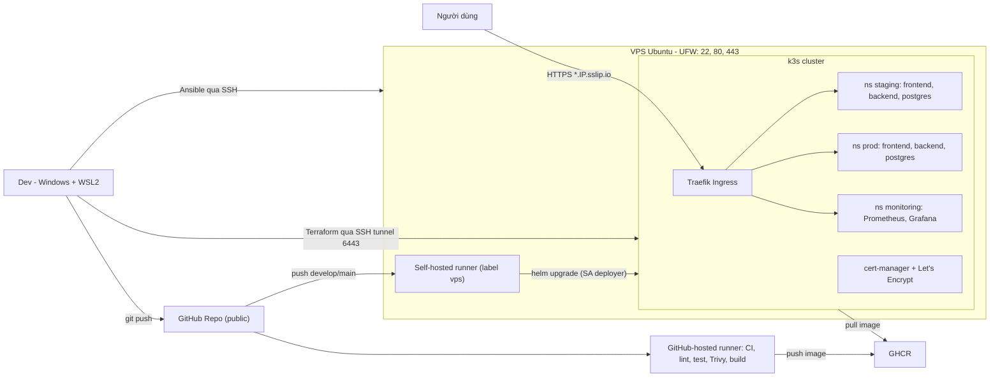
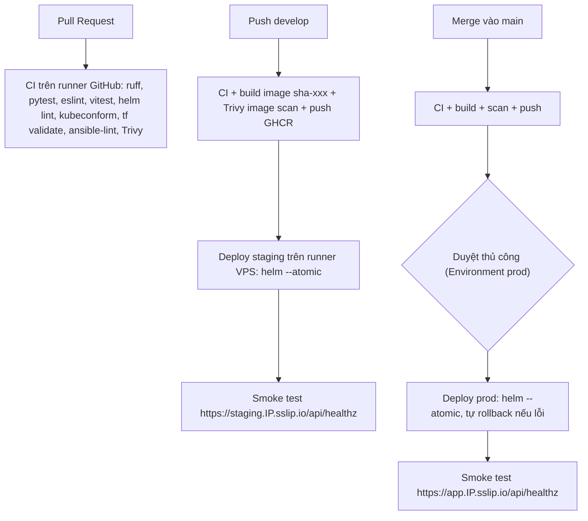

# MASTER PLAN: Quy trình DevOps hoàn chỉnh trên VPS (k3s + IaC + GitHub Actions)

> File này là nguồn sự thật duy nhất (single source of truth) của dự án.
> Agent phải đọc file này trước mỗi phiên làm việc, làm đúng thứ tự task, và cập nhật checklist sau khi hoàn thành.

## 0. Cách agent làm việc với plan này

1. Mở mục **Tiến độ** (mục 7), tìm task đầu tiên chưa xong (`[ ]`).
2. Đọc kỹ task đó trong mục 6: mục tiêu, hướng dẫn, skill tham khảo, tiêu chí hoàn thành.
3. Kích hoạt các skill liên quan trong `.kiro/skills/` (cột "Skill" của từng task).
4. Với bước có nhãn **[Bạn]**: dừng lại, hướng dẫn người dùng làm từng bước, chờ xác nhận rồi mới làm tiếp.
5. Làm xong thì chạy test của task. Chỉ đánh dấu `[x]` khi mọi tiêu chí hoàn thành đều đạt.
6. Ghi lại quyết định quan trọng hoặc sai lệch so với plan vào mục 8 (**Nhật ký quyết định**).
7. Không tự ý mở rộng phạm vi. Muốn thêm hạng mục ngoài plan thì hỏi người dùng trước.

## 1. Mục tiêu

Xây dựng quy trình DevOps đầy đủ cho một ứng dụng full-stack đơn giản ("Task Manager"):

- Hạ tầng và cấu hình được định nghĩa bằng code (Ansible + Terraform).
- CI/CD tự động bằng GitHub Actions.
- Ứng dụng chạy trên Kubernetes (k3s) trên 1 VPS.
- 2 môi trường staging và prod, HTTPS tự động, quét bảo mật, monitoring.

## 2. Yêu cầu đã chốt

| Hạng mục | Lựa chọn |
|---|---|
| Hạ tầng | 1 VPS Ubuntu 22.04/24.04 LTS, 4 vCPU/8GB RAM, IPv4 public, mở được port 80/443. VPS không có API. Chưa mua. |
| Kubernetes | k3s 1 node. Staging và prod tách bằng namespace. |
| IaC | Ansible: cấu hình server, cài k3s, cài runner. Terraform: tài nguyên trên cluster (namespace, RBAC, cert-manager, monitoring). |
| App | React (Vite + TypeScript) + FastAPI (Python 3.12) + PostgreSQL |
| CI | Lint, test, build Docker image, Trivy scan, push GHCR |
| CD | Helm, staging tự động, prod có duyệt thủ công |
| HTTPS | cert-manager + Let's Encrypt (HTTP-01 qua Traefik) |
| Monitoring | kube-prometheus-stack (Prometheus + Grafana + Alertmanager) |
| Tên miền | sslip.io, ví dụ `app.<IP>.sslip.io`. Khai báo bằng biến `base_domain`. |
| Deploy | Self-hosted runner trên VPS (label `vps`). Không mở port 6443. |
| Máy dev | Windows + WSL2 (Ubuntu) để chạy Ansible/Terraform/kubectl/helm |
| Repo | Public trên GitHub |
| Phát triển app | Local bằng Docker Compose. Hạ tầng làm trực tiếp trên VPS. |
| Nhánh | `develop` → staging, `main` → prod |

## 3. Quyết định kỹ thuật và lưu ý quan trọng

- **Ansible chỉ chạy trên Linux** nên mọi lệnh Ansible/Terraform/kubectl/helm chạy trong WSL2.
- **Truy cập Kubernetes API**: dùng SSH tunnel `ssh -L 6443:127.0.0.1:6443 deploy@<IP>`. UFW chặn 6443 từ bên ngoài.
- **Terraform state**: `backend "kubernetes"` lưu state trong một Secret của cluster (namespace `kube-system`).
- **Lỗi CRD khi plan**: không dùng `kubernetes_manifest` cho ClusterIssuer. Đóng gói ClusterIssuer thành chart local `infra/terraform/charts/cluster-issuers` và deploy bằng `helm_release` có `depends_on` cert-manager.
- **PostgreSQL**: không dùng chart Bitnami (đã đổi chính sách phân phối image từ 2025). Tự viết StatefulSet dùng image chính thức `postgres` (pin phiên bản), PVC dùng StorageClass `local-path` có sẵn trong k3s.
- **Ingress**: dùng Traefik có sẵn trong k3s, `ingressClassName: traefik`.
- **Let's Encrypt**: luôn thử bằng `letsencrypt-staging` trước. Nếu sslip.io bị giới hạn cấp chứng chỉ (rate limit) thì chuyển sang DuckDNS bằng cách đổi `base_domain`.
- **Bảo mật repo public + self-hosted runner**:
  - Job có `runs-on: [self-hosted, vps]` chỉ chạy khi `push` lên `develop`/`main`. Tuyệt đối không chạy khi có `pull_request` hay `pull_request_target`.
  - Bật Settings → Actions → "Require approval for all outside collaborators".
  - Runner chạy bằng user riêng, không phải root, không có sudo.
  - Runner dùng kubeconfig của ServiceAccount `deployer`, chỉ có quyền trong namespace `staging` và `prod`.
- **GitHub Actions**: action chính thức (`actions/*`, `docker/*`) pin theo tag phiên bản. Action bên thứ ba (ví dụ Trivy) pin theo **commit SHA**.
- **Image**: tag `sha-<7 ký tự>`, không dùng `latest`. Package GHCR để public để cluster pull không cần credential.
- **Pin phiên bản**: k3s, Helm chart, Terraform provider, image, thư viện. Ghi lại phiên bản đã chọn vào mục 8.
- **Secret**: không commit secret. Dùng Ansible Vault (token runner), GitHub Environment secrets (mật khẩu DB), `terraform.tfvars` nằm trong `.gitignore`.
- **Ngân sách RAM 8GB**: k3s khoảng 1GB, kube-prometheus-stack (đã giảm tài nguyên) khoảng 2GB, app × 2 môi trường khoảng 1–1.5GB.

## 4. Kiến trúc

### 4.1. Tổng thể



### 4.2. Luồng CI/CD



### 4.3. Hostname

| Thành phần | URL |
|---|---|
| Staging | `https://staging.<IP>.sslip.io` |
| Prod | `https://app.<IP>.sslip.io` |
| Grafana | `https://grafana.<IP>.sslip.io` |

Ingress của mỗi môi trường định tuyến `/` tới frontend và `/api` tới backend. Frontend gọi API bằng đường dẫn tương đối nên không cần cấu hình CORS.

## 5. Cấu trúc repo

```
.
├── .kiro/
│   ├── steering/project.md          # Quy ước dự án cho Kiro
│   └── skills/                      # Skill tham khảo (xem mục 9)
├── docs/
│   ├── MASTER_PLAN.md               # File này
│   ├── setup-wsl.md
│   ├── architecture.md
│   ├── runbook.md
│   └── demo-script.md
├── app/
│   ├── backend/                     # FastAPI, SQLAlchemy, Alembic, pytest
│   └── frontend/                    # React + Vite, Vitest, nginx
├── docker-compose.yml
├── .env.example
├── helm/taskapp/                    # Chart ứng dụng + values-staging.yaml, values-prod.yaml
├── infra/
│   ├── ansible/
│   │   ├── inventory/hosts.yml
│   │   ├── group_vars/
│   │   ├── playbooks/site.yml
│   │   └── roles/                   # common, security, k3s, github_runner
│   └── terraform/                   # namespaces, RBAC, cert-manager, issuers, monitoring
│       └── charts/cluster-issuers/
├── scripts/                         # smoke-test.sh, tunnel.sh, load-test.sh
└── .github/
    ├── workflows/                   # ci.yml, cd.yml
    └── dependabot.yml
```

## 6. Danh sách task

Quy ước:
- **[Bạn]**: việc người dùng phải tự làm. Agent hướng dẫn chi tiết rồi chờ xác nhận.
- Task 1–6 làm hoàn toàn trên máy local, chưa cần VPS. Chỉ cần mua VPS trước Task 7.

---

### Task 1: Khởi tạo repo và môi trường WSL2

**Skill:** `git-workflow`

**Mục tiêu:** có repo với cấu trúc thư mục chuẩn và đủ công cụ trên máy dev.

**Hướng dẫn:**
- Tạo khung thư mục như mục 5 (thư mục rỗng thì đặt `.gitkeep`).
- Tạo `.gitignore` bao gồm: Python, Node, Terraform (`.terraform/`, `*.tfstate*`, `terraform.tfvars`), kubeconfig (`*.kubeconfig`, `config-vps`), `.env`, file vault đã giải mã.
- Tạo `README.md` giới thiệu ngắn và link tới `docs/MASTER_PLAN.md`.
- Viết `docs/setup-wsl.md` hướng dẫn:
  - Cài WSL2 + Ubuntu 24.04.
  - Cài Python 3.12, pipx, Ansible (qua pipx), Terraform, kubectl, Helm, tflint, kubeconform.
  - Cài Docker Desktop và bật tích hợp WSL.
  - Cài Node.js LTS.
  - Tạo SSH key (`ssh-keygen -t ed25519`).
  - Lưu ý: clone repo vào filesystem của WSL (`~/projects/...`), không clone vào `/mnt/d/...` (chậm và lỗi quyền file với Ansible).
- Tạo nhánh `main` và `develop`.
- **[Bạn]** Tạo repo public trên GitHub, push cả 2 nhánh.

**Tiêu chí hoàn thành:**
- [x] Trong WSL, các lệnh `ansible --version`, `terraform version`, `kubectl version --client`, `helm version`, `docker version`, `node --version` đều chạy được.
- [x] Repo trên GitHub có đủ cấu trúc, nhánh `main` và `develop`.

---

### Task 2: Backend FastAPI (TDD)

**Skill:** `postgresql`

**Mục tiêu:** API CRUD cho `tasks` dùng PostgreSQL.

**Hướng dẫn:**
- Python 3.12, FastAPI, SQLAlchemy 2.x, Alembic (migration), pydantic-settings đọc `DATABASE_URL`. Pin phiên bản trong `requirements.txt` (hoặc `pyproject.toml` + lock).
- Model `Task`: `id`, `title` (bắt buộc, 1–200 ký tự), `done` (bool), `created_at`.
- Endpoint:
  - `GET /api/healthz`: liveness, không phụ thuộc DB.
  - `GET /api/readyz`: readiness, kiểm tra kết nối DB.
  - `GET /api/tasks`, `POST /api/tasks`, `PATCH /api/tasks/{id}`, `DELETE /api/tasks/{id}`.
  - `GET /metrics`: dùng `prometheus-fastapi-instrumentator`.
- Validate input bằng pydantic, trả 404/422 đúng chuẩn.
- Lint bằng `ruff` (cấu hình trong `pyproject.toml`).

**Test:**
- Viết pytest trước cho từng endpoint, dùng PostgreSQL thật (container local, service container trong CI).
- Coverage tối thiểu 80% (`pytest --cov --cov-fail-under=80`).

**Tiêu chí hoàn thành:**
- [x] `ruff check` và `pytest` pass.
- [x] Chạy `uvicorn`, mở `/docs` thao tác CRUD được. (Swagger UI nằm ở `/api/docs`, xem mục 8.)

---

### Task 3: Frontend React

**Mục tiêu:** giao diện xem, thêm, đánh dấu hoàn thành và xóa task.

**Hướng dẫn:**
- Vite + React + TypeScript. Gọi API qua đường dẫn tương đối `/api`.
- Khi dev: Vite proxy `/api` → `http://localhost:8000`.
- Accessibility cơ bản: input có `<label>`, nút có text rõ ràng, điều khiển được bằng bàn phím, có trạng thái loading/lỗi.
- Lint bằng ESLint.

**Test:** Vitest + React Testing Library cho component danh sách và form, mock `fetch`.

**Tiêu chí hoàn thành:**
- [x] `npm run lint`, `npm test -- --run`, `npm run build` đều pass.
- [x] `npm run dev` hoạt động với backend local.

---

### Task 3B: Mở rộng app theo hướng Todoist

**Skill:** `postgresql`

**Mục tiêu:** app đủ chỉn chu để demo: dự án, nhãn, ưu tiên, ngày hết hạn, view Hôm nay/Sắp tới, thêm nhanh bằng ngôn ngữ tự nhiên.

**Hướng dẫn:** chi tiết trong [`docs/app-feature-plan.md`](app-feature-plan.md) (phân tích, thiết kế, mô hình dữ liệu, API) và mockup [`docs/design/mockup-today.svg`](design/mockup-today.svg). Làm theo 5 bước, mỗi bước một commit:

- B1. Backend: migration 0002, API projects/labels/tasks mở rộng, lọc, smart sort, subtask.
- B2. Nền frontend: react-router, react-query, tokens + CSS Modules, AppShell, Sidebar responsive, chế độ tối.
- B3. Các view danh sách, hoàn thành lạc quan + Hoàn tác.
- B4. Thêm nhanh (parser ngôn ngữ tự nhiên), hộp thoại chi tiết, picker, subtask.
- B5. Phím tắt, trạng thái trống, skeleton, rà soát accessibility.

**Tiêu chí hoàn thành:**
- [x] B1: pytest pass, coverage ≥ 80%, `alembic upgrade head` và `downgrade base` chạy được, `POST /api/tasks {"title"}` vẫn tương thích.
- [x] B2–B5: `npm run lint`, `npm test -- --run`, `npm run build` pass. Parser có ≥ 40 test case.
- [x] Chạy với backend thật: dùng được mọi view trên desktop và mobile, sáng và tối, chỉ bằng bàn phím. (Kiểm tra bằng ảnh chụp Edge headless, test bàn phím trong Vitest. Người dùng đồng ý chuyển sang Task 4.)

---

### Task 4: Docker hóa và Docker Compose

**Skill:** `docker-management`, `docker-compose`, `container-hardening`

**Mục tiêu:** chạy cả stack bằng một lệnh.

**Hướng dẫn:**
- `app/backend/Dockerfile`:
  - Multi-stage, base `python:3.12-slim` (pin phiên bản).
  - Chạy bằng user không phải root.
  - Entrypoint chạy `alembic upgrade head` rồi khởi động `uvicorn`.
- `app/frontend/Dockerfile`:
  - Stage build dùng Node, stage chạy dùng `nginxinc/nginx-unprivileged` (port 8080).
  - `nginx.conf` có SPA fallback và proxy `/api` tới backend (chỉ dùng cho Compose; trên K8s thì Ingress lo việc định tuyến).
- `docker-compose.yml`: postgres, backend, frontend, có healthcheck, volume cho DB, cấu hình qua `.env`. Commit `.env.example`, không commit `.env`.
- `scripts/smoke-test.sh <base_url>`: kiểm tra `/api/healthz`, tạo một task, đọc lại rồi xóa. Có `set -euo pipefail`, trả exit code khác 0 khi lỗi, có retry ngắn.
- Thêm `.dockerignore` cho cả hai app.

**Tiêu chí hoàn thành:**
- [x] `docker compose up -d --build` chạy xong, cả 3 service healthy.
- [x] `scripts/smoke-test.sh http://localhost:8080` pass.

---

### Task 5: Pipeline CI (runner của GitHub)

**Skill:** `github-actions`, `container-scanning`

**Mục tiêu:** mọi PR và push đều được kiểm tra tự động, image được đẩy lên GHCR.

**Hướng dẫn:**
- `.github/workflows/ci.yml`, trigger: `pull_request` và `push` lên `develop`/`main`.
- `permissions` mặc định chỉ `contents: read`. Job push image mới có `packages: write`.
- Các job:
  - `backend`: ruff + pytest, có postgres service container.
  - `frontend`: eslint + vitest + build.
  - `build`: Docker Buildx build 2 image, cache `type=gha`.
  - Trivy scan image: fail khi có lỗ hổng `CRITICAL,HIGH` đã có bản vá (`ignore-unfixed: true`).
  - Chỉ push image lên `ghcr.io/<owner>/taskapp-backend` và `taskapp-frontend` khi event là `push`. Tag `sha-<short>`.
- Thêm `concurrency` để hủy các lần chạy cũ cùng nhánh. Cache pip/npm.
- Toàn bộ job trong `ci.yml` dùng `runs-on: ubuntu-latest`, **không** dùng self-hosted.
- **[Bạn]** Sau lần push đầu tiên, vào Packages, đặt 2 package ở chế độ Public.

**Tiêu chí hoàn thành:**
- [x] PR cố tình làm test fail thì CI đỏ, sửa lại thì CI xanh. (PR #1, nhánh `demo/ci-red-green`)
- [x] Push lên `develop` thì 2 image xuất hiện trên GHCR với tag `sha-xxx`. (`sha-affc581`, pull ẩn danh được)

---

### Task 6: Helm chart ứng dụng

**Skill:** `helm-charts`, `kubernetes-ops`, `kubernetes-hardening`

**Mục tiêu:** đóng gói app thành chart deploy được lên Kubernetes.

**Hướng dẫn:**
- `helm/taskapp/templates`:
  - Deployment frontend và backend: liveness/readiness probe, resources requests/limits, `securityContext` (non-root, `readOnlyRootFilesystem` nếu được, drop ALL capabilities).
  - StatefulSet postgres dùng image chính thức, PVC `local-path`, Service headless.
  - Service cho từng thành phần.
  - Ingress: `ingressClassName: traefik`, annotation `cert-manager.io/cluster-issuer`, TLS, path `/` → frontend và `/api` → backend.
  - Secret DB: dùng `existingSecret` (secret tạo từ pipeline), chart không chứa mật khẩu.
  - `serviceMonitor.enabled` (mặc định `false`, bật ở Task 12).
  - `networkPolicy.enabled` (mặc định `false`, bật ở Task 13).
  - `basicAuth.enabled` + `basicAuth.existingSecret`: Traefik `Middleware` (`traefik.io/v1alpha1`, `basicAuth`) gắn vào Ingress qua annotation `traefik.ingress.kubernetes.io/router.middlewares`. Secret (htpasswd) do pipeline tạo, chart không chứa mật khẩu. Xem Task 3B, quyết định đăng nhập.
- `values.yaml` mặc định, cùng `values-staging.yaml` và `values-prod.yaml` (khác nhau ở host, replicas, resources, issuer).
- Bổ sung vào CI: `helm lint`, `helm template ... | kubeconform -strict -ignore-missing-schemas` cho cả 2 file values.

**Test:** CI pass. Có thể thêm `helm-unittest` để kiểm tra Ingress host và image tag (tùy chọn).

**Tiêu chí hoàn thành:**
- [x] `helm lint` và kubeconform pass trong CI với cả staging và prod values.

---

### Task 7: [Bạn] Mua VPS + Ansible baseline (common, security)

**Skill:** `linux-hardening`, `firewall-config`, `ssh-configuration`

**Mục tiêu:** server đã được hardening, quản lý hoàn toàn bằng code.

**Hướng dẫn:**
- **[Bạn]** Mua VPS đúng yêu cầu ở mục 2, chọn Ubuntu 24.04, thêm SSH public key, gửi IP cho agent. IP không commit lên repo public mà để trong `inventory/hosts.yml` (gitignore) hoặc biến môi trường. Commit file `hosts.example.yml`.
- `infra/ansible/`: `ansible.cfg`, `inventory/`, `group_vars/all.yml`, `group_vars/all/vault.yml` (Ansible Vault), `playbooks/site.yml`, `requirements.yml` (pin collection `community.general`, `ansible.posix`).
- Role `common`:
  - Tạo user `deploy` có SSH key và sudo.
  - Cập nhật gói, bật `unattended-upgrades`, đặt timezone `Asia/Ho_Chi_Minh`, swap 2GB.
- Role `security`:
  - UFW: mặc định deny incoming, chỉ allow 22, 80, 443. **Mở 22 trước khi enable UFW.**
  - fail2ban cho sshd.
  - sshd: `PasswordAuthentication no`, `PermitRootLogin no`, validate bằng `sshd -t` trước khi reload (dùng `validate:` trong task template).
- **Không chạy trực tiếp** các script `harden-system.sh` / `setup-ufw.sh` trong skill. Chỉ tham khảo nội dung và viết lại thành task Ansible idempotent. Script `setup-ufw.sh` không mở 80/443 nên không dùng được nguyên bản.
- An toàn: giữ một phiên SSH đang mở trong suốt lúc áp cấu hình sshd/UFW.
- Bổ sung vào CI: `ansible-lint` và `ansible-playbook --syntax-check`.

**Tiêu chí hoàn thành:**
- [ ] Chạy playbook lần 2 cho kết quả `changed=0`.
- [ ] SSH bằng password và SSH bằng root đều bị từ chối. SSH bằng key qua user `deploy` vẫn được.
- [ ] `sudo ufw status` chỉ hiển thị 22, 80, 443.

---

### Task 8: Ansible role k3s

**Skill:** `kubernetes-ops`, `ssh-configuration`

**Mục tiêu:** cluster k3s chạy được, truy cập được từ WSL qua SSH tunnel.

**Hướng dẫn:**
- Role `k3s`:
  - Cài k3s theo phiên bản pin (`INSTALL_K3S_VERSION`). Tải script cài đặt về file, không pipe thẳng vào shell.
  - Giữ Traefik và local-path.
  - `write-kubeconfig-mode: "0600"`.
  - Fetch kubeconfig về máy dev thành `~/.kube/config-vps`, thay server thành `https://127.0.0.1:6443`.
- `scripts/tunnel.sh`: mở SSH tunnel `-L 6443:127.0.0.1:6443` chạy nền.
- Biến `base_domain: "<IP>.sslip.io"` trong `group_vars` (hoặc tính từ IP).
- Kiểm tra thủ công: deploy pod `traefik/whoami` + Service + Ingress HTTP với host `test.<IP>.sslip.io` (manifest để trong `infra/k8s-test/`, xóa sau Task 9).

**Tiêu chí hoàn thành:**
- [ ] `KUBECONFIG=~/.kube/config-vps kubectl get nodes` trả về `Ready` qua tunnel.
- [ ] Từ bên ngoài `nc -vz <IP> 6443` thất bại.
- [ ] `http://test.<IP>.sslip.io` hiển thị trang whoami.
- [ ] Playbook chạy lần 2 có `changed=0`.

---

### Task 9: Terraform nền tảng (namespace, RBAC, cert-manager, HTTPS)

**Skill:** `ssl-tls-management`, `kubernetes-hardening`

**Mục tiêu:** thành phần nền của cluster được quản lý bằng Terraform.

**Hướng dẫn:**
- `infra/terraform/`: `versions.tf` (pin Terraform và provider `hashicorp/kubernetes`, `hashicorp/helm`), `backend.tf` (`backend "kubernetes"`, `secret_suffix = "platform"`, `config_path = "~/.kube/config-vps"`), `variables.tf`, `main.tf`, `outputs.tf`, `terraform.tfvars.example`.
- Tài nguyên:
  - Namespace `staging`, `prod`, `monitoring`. Gắn label Pod Security Standards (`pod-security.kubernetes.io/enforce: baseline` cho staging/prod).
  - ServiceAccount `deployer` (namespace `kube-system` hoặc `ci`). Role trong `staging` và `prod` cho phép quản lý deployments, statefulsets, services, ingresses, secrets, configmaps, pvc, pods (đọc/log), servicemonitors, prometheusrules, networkpolicies. RoleBinding tương ứng.
  - Secret token cho SA `deployer` (type `kubernetes.io/service-account-token`). Output kubeconfig dạng sensitive để dùng ở Task 10.
  - `helm_release` cert-manager (pin phiên bản, `crds.enabled=true`).
  - `helm_release` chart local `charts/cluster-issuers` tạo `letsencrypt-staging` và `letsencrypt-prod` (ACME HTTP-01, ingress class `traefik`), có `depends_on` cert-manager.
- Biến: `base_domain`, `acme_email`, `kubeconfig_path`.
- Chuyển Ingress whoami sang HTTPS với issuer staging, kiểm tra xong chuyển sang prod.
- Bổ sung vào CI: `terraform fmt -check -recursive`, `terraform init -backend=false` + `validate`, `tflint`.

**Tiêu chí hoàn thành:**
- [ ] Sau `terraform apply`, chạy `terraform plan` báo "No changes".
- [ ] `https://test.<IP>.sslip.io` có chứng chỉ Let's Encrypt hợp lệ (issuer prod).
- [ ] `kubectl auth can-i` với SA `deployer`: được phép trong `staging`/`prod`, bị từ chối trong `kube-system`/`monitoring`.
- [ ] Đã xóa tài nguyên whoami test.

---

### Task 10: Self-hosted runner + CD lên staging

**Skill:** `github-actions`, `helm-charts`

**Mục tiêu:** push lên `develop` thì app tự động lên staging.

**Hướng dẫn:**
- Role Ansible `github_runner`:
  - Tạo user `gh-runner` (không sudo).
  - Tải actions runner theo phiên bản pin, kiểm tra checksum.
  - Đăng ký runner với label `vps`, cài dạng systemd service chạy bằng `gh-runner`.
  - Cài `kubectl` và `helm` (pin phiên bản).
  - Đặt kubeconfig của SA `deployer` (output từ Task 9) vào `~gh-runner/.kube/config` với mode `0600`.
  - **[Bạn]** Lấy registration token (Settings → Actions → Runners → New self-hosted runner), lưu vào Ansible Vault. Token hết hạn sau 1 giờ nên phải chạy role ngay sau khi lấy.
- **[Bạn]** Bật Settings → Actions → General → "Require approval for all outside collaborators".
- **[Bạn]** Tạo Environment `staging` với secret `DB_PASSWORD`, giới hạn deploy từ nhánh `develop`.
- `.github/workflows/cd.yml` (hoặc thêm job vào `ci.yml` với `needs`):
  - Chỉ trigger khi `push` lên `develop` (staging) và `main` (prod, Task 11). **Không có trigger `pull_request`.**
  - Job `deploy-staging`: `needs` job build/push, `runs-on: [self-hosted, vps]`, `environment: staging`.
  - Các bước:
    1. Tạo hoặc cập nhật Secret DB: `kubectl create secret generic taskapp-db --from-literal=... --dry-run=client -o yaml | kubectl apply -f -`.
    2. `helm upgrade --install taskapp ./helm/taskapp -n staging -f helm/taskapp/values-staging.yaml --set image.tag=sha-xxx --set ingress.host=staging.<base_domain> --atomic --wait --timeout 5m`.
    3. `scripts/smoke-test.sh https://staging.<base_domain>`.
  - `base_domain` lưu dưới dạng GitHub Actions variable (`vars.BASE_DOMAIN`).

**Tiêu chí hoàn thành:**
- [ ] Runner hiển thị trạng thái Idle với label `vps` trên GitHub.
- [ ] Sửa giao diện, push `develop`, thay đổi xuất hiện trên `https://staging.<IP>.sslip.io`, smoke test pass trong pipeline.
- [ ] PR (từ nhánh hoặc fork) chỉ chạy CI trên runner GitHub, không có job nào chạy trên runner `vps`.

---

### Task 11: CD lên prod có duyệt thủ công + rollback

**Skill:** `github-actions`, `git-workflow`, `runbook-creation`

**Mục tiêu:** luồng phát hành lên prod an toàn.

**Hướng dẫn:**
- **[Bạn]** Tạo Environment `prod`: required reviewer là bạn, chỉ cho deploy từ nhánh `main`, secret `DB_PASSWORD` riêng.
- **[Bạn]** Branch protection (ruleset) cho `main` và `develop`: bắt buộc qua PR, bắt buộc CI pass, cấm force push.
- Job `deploy-prod`: chạy khi push `main`, `environment: prod`, dùng `values-prod.yaml`, host `app.<base_domain>`, `--atomic`, cuối cùng chạy smoke test.
- Viết `docs/runbook.md` mục "Rollback": `helm history`, `helm rollback taskapp <rev> -n prod`, kiểm tra lại bằng smoke test.

**Tiêu chí hoàn thành:**
- [ ] Merge `develop` → `main`, job prod chờ duyệt, bấm duyệt thì prod cập nhật, smoke test pass.
- [ ] Cố tình deploy staging với readiness probe sai: `--atomic` tự rollback, job báo đỏ, staging vẫn chạy bản cũ (smoke test thủ công pass). Sau đó revert thay đổi lỗi.

---

### Task 12: Monitoring (Prometheus + Grafana)

**Skill:** `prometheus-grafana`

**Mục tiêu:** quan sát được cluster và ứng dụng.

**Hướng dẫn:**
- Terraform `helm_release` kube-prometheus-stack (pin phiên bản) trong namespace `monitoring`:
  - Giảm resources. Retention 7 ngày, PVC Prometheus 5Gi.
  - Tắt các thành phần k3s không expose (kube-controller-manager, kube-scheduler, kube-proxy, etcd) để tránh target down giả.
  - `serviceMonitorSelectorNilUsesHelmValues=false`, `ruleSelectorNilUsesHelmValues=false` để nhận ServiceMonitor/Rule từ mọi namespace.
  - Grafana: Ingress HTTPS `grafana.<base_domain>`, mật khẩu admin từ biến sensitive `grafana_admin_password`, bật sidecar dashboard.
- Chart app:
  - Bật `serviceMonitor` cho backend (path `/metrics`).
  - ConfigMap dashboard (label `grafana_dashboard: "1"`): request rate, latency p95, tỉ lệ lỗi 5xx, theo namespace.
  - PrometheusRule: `BackendDown` (`up == 0` trong 2 phút), `HighErrorRate` (5xx > 5% trong 5 phút).
- `scripts/load-test.sh <base_url>`: tạo traffic bằng vòng lặp `curl` hoặc `hey`.
- Cấp thêm quyền cho Role `deployer` với `servicemonitors` và `prometheusrules` (nếu Task 9 chưa có).

**Tiêu chí hoàn thành:**
- [ ] Prometheus → Targets: backend staging và prod đều `UP`.
- [ ] Chạy load test, dashboard Grafana hiển thị traffic.
- [ ] Scale backend staging về 0, alert `BackendDown` chuyển firing. Scale lại thì alert hết.
- [ ] `free -h` trên VPS: RAM dùng dưới 75%.

---

### Task 13: Tăng cường bảo mật (DevSecOps)

**Skill:** `container-scanning`, `dependency-scanning`, `kubernetes-hardening`, `github-actions`

**Mục tiêu:** hoàn thiện phần security của pipeline và cluster.

**Hướng dẫn:**
- Trivy `config` (misconfiguration) scan cho Dockerfile, Helm chart, Terraform. Xuất SARIF và upload bằng `github/codeql-action/upload-sarif` lên tab Security (cần `security-events: write`).
- Trivy `fs` scan dependency của repo.
- `.github/dependabot.yml`: ecosystem `pip`, `npm`, `github-actions`, `docker`, lịch weekly, target nhánh `develop`.
- Rà soát lại toàn bộ workflow: `permissions` tối thiểu cho từng job, action bên thứ ba pin theo SHA.
- Bật `networkPolicy.enabled=true` trong values:
  - Default deny ingress trong namespace app.
  - Cho phép Traefik (namespace `kube-system`) vào frontend/backend.
  - Chỉ backend vào được postgres:5432.
  - Cho phép Prometheus (namespace `monitoring`) scrape backend.
- Bật GitHub secret scanning và push protection (Settings → Code security). **[Bạn]**

**Tiêu chí hoàn thành:**
- [ ] Tab Security hiển thị kết quả Trivy.
- [ ] `kubectl run test --rm -it --image=busybox -n staging -- nc -zv <postgres-svc> 5432` bị chặn. Backend vẫn hoạt động (smoke test pass).
- [ ] Prometheus vẫn scrape được backend sau khi bật NetworkPolicy.

---

### Task 14: Tài liệu và kịch bản demo

**Skill:** `runbook-creation`

**Mục tiêu:** bộ tài liệu đủ để báo cáo và bảo vệ đồ án.

**Hướng dẫn:**
- `docs/architecture.md`: sơ đồ mermaid (mục 4), giải thích từng thành phần và lý do chọn.
- `docs/runbook.md`:
  - Dựng lại toàn bộ từ VPS trắng: Ansible → Terraform → runner → push code.
  - Xoay vòng secret (DB password, Grafana, runner token).
  - Rollback.
  - Xử lý sự cố thường gặp: cert không cấp được, pod CrashLoop, runner offline, hết RAM/disk.
  - Chi phí.
- `docs/demo-script.md`: kịch bản demo theo thứ tự PR → CI đỏ/xanh → merge `develop` → staging → PR lên `main` → duyệt → prod → Grafana → rollback → NetworkPolicy.
- Cập nhật `README.md`: badge CI, link tới các URL, mô tả nhanh.

**Tiêu chí hoàn thành:**
- [ ] Chạy lại `ansible-playbook site.yml` (`changed=0`) và `terraform plan` (No changes) trên server hiện tại.
- [ ] Thực hiện trọn kịch bản demo không lỗi.

---

## 7. Tiến độ

- [x] Task 1: Khởi tạo repo và môi trường WSL2
- [x] Task 2: Backend FastAPI (TDD)
- [x] Task 3: Frontend React
- [x] Task 3B: Mở rộng app theo hướng Todoist
- [x] Task 4: Docker hóa và Docker Compose
- [x] Task 5: Pipeline CI
- [x] Task 6: Helm chart ứng dụng
- [ ] Task 7: Mua VPS + Ansible baseline
- [ ] Task 8: Ansible role k3s
- [ ] Task 9: Terraform nền tảng
- [ ] Task 10: Self-hosted runner + CD staging
- [ ] Task 11: CD prod + rollback
- [ ] Task 12: Monitoring
- [ ] Task 13: Tăng cường bảo mật
- [ ] Task 14: Tài liệu và demo

## 8. Nhật ký quyết định

Ghi theo mẫu: `YYYY-MM-DD | Task N | Quyết định / phiên bản đã pin / sai lệch so với plan | Lý do`

| Ngày | Task | Nội dung | Lý do |
|---|---|---|---|
| 2026-10-16 | - | Chốt plan, chọn sslip.io cho tên miền | Miễn phí, không cần đăng ký |
| 2026-10-16 | 1 | Pin tool máy dev: Terraform 1.16.6, kubectl v1.36.5, Helm v4.3.1, tflint v0.64.0, kubeconform v0.8.0, Node.js v24.22.0 (LTS), ansible 14.5.0 (ansible-core 2.21), ansible-lint 26.10.1 | Bản ổn định mới nhất tại thời điểm làm. kubectl chọn 1.36 để khớp kênh stable của k3s (v1.36.5+k3s1) |
| 2026-10-16 | 1 | Dùng Helm 4: ở Task 10/11 dùng `--rollback-on-failure` thay cho `--atomic` | Helm 4 đổi tên `--atomic` (vẫn chạy nhưng deprecated, sẽ bị bỏ). Helm 3 sắp hết hỗ trợ |
| 2026-10-16 | 1 | Thêm `scripts/setup-wsl-tools.sh` (cài tool vào `~/.local/bin`, kiểm tra SHA-256, chạy lại được) và `.gitattributes` (ép LF) | Ngoài cấu trúc mục 5 nhưng giúp cài đặt lặp lại được, và tránh lỗi CRLF khi sửa file trên Windows rồi chạy trong WSL |
| 2026-10-16 | 1 | Repo được khởi tạo tại workspace Windows (`D:\`), sau khi push lên GitHub thì clone vào `~/projects` trong WSL để làm từ Task 7 | Kiro đang mở workspace trên ổ D. Task 2–6 không bị ảnh hưởng, Ansible bắt buộc phải chạy trong filesystem WSL |
| 2026-10-16 | 1 | Repo GitHub: `nhatminh0113/main-dev` (public), push lần đầu qua HTTPS (Git Credential Manager). SSH key tạo sau, bắt buộc có trước Task 7 | Người dùng chưa có SSH key, tiêu chí Task 1 không phụ thuộc SSH key |
| 2026-10-16 | 2 | Pin backend: fastapi 0.143.2, uvicorn 0.54.0, sqlalchemy 2.1.4, alembic 1.20.0, psycopg[binary] 3.3.6, pydantic 2.14.1, pydantic-settings 2.16.0, prometheus-fastapi-instrumentator 8.1.0; dev: pytest 9.1.1, pytest-cov 7.1.0, httpx2 2.13.1, ruff 0.17.1 | Bản mới nhất trên PyPI, tương thích Python 3.12 |
| 2026-10-16 | 2 | PostgreSQL dùng image `postgres:18.6-alpine` (test local, sau này dùng cho Compose/Helm) | Bản 18 mới nhất. Lưu ý: từ PG 18, image đặt dữ liệu ở `/var/lib/postgresql/18/docker`, volume phải mount vào `/var/lib/postgresql` (không phải `/var/lib/postgresql/data`) |
| 2026-10-16 | 2 | Swagger UI ở `/api/docs`, OpenAPI ở `/api/openapi.json` (thay vì `/docs`) | Ingress chỉ chuyển `/api` tới backend, đặt dưới `/api` thì xem được docs trên staging/prod |
| 2026-10-16 | 2 | Thêm `GET /api/tasks/{id}` ngoài 4 endpoint trong plan | Smoke test (Task 4) cần "đọc lại" đúng task vừa tạo |
| 2026-10-16 | 2 | Dùng `httpx2` thay `httpx` cho TestClient | Starlette 1.8 báo `httpx` deprecated cho `starlette.testclient` |
| 2026-10-16 | 2 | `/metrics` không đo chính nó và `/api/healthz`, `/api/readyz`. `/metrics` không có trong OpenAPI. `DATABASE_URL` dạng `postgresql://` được tự đổi sang driver psycopg | Probe của Kubernetes không làm nhiễu biểu đồ request rate. Secret DB có thể dùng URL chuẩn |
| 2026-10-16 | 3 | Pin frontend (exact, có `package-lock.json`): react/react-dom 19.3.1, vite 8.3.4, @vitejs/plugin-react 6.1.2, typescript 6.0.3, vitest 5.0.5, jsdom 30.1.3, @testing-library/react 16.3.3, eslint 10.12.0, typescript-eslint 8.71.2, eslint-plugin-react-hooks 7.1.1 | Bản mới nhất tương thích nhau. TypeScript 7 chưa được typescript-eslint hỗ trợ (`<6.1.0`) |
| 2026-10-16 | 3 | Dùng `eslint-plugin-jsx-a11y-x` 0.2.0 (fork của es-tooling) thay `eslint-plugin-jsx-a11y` | Bản gốc chưa hỗ trợ ESLint 10 và không cập nhật từ 2024. ESLint 9 đã hết hỗ trợ |
| 2026-10-16 | 3 | Giao diện: CSS thuần + design tokens (CSS variables), không dùng UI framework. Tự động sáng/tối, tương phản AA, viền focus rõ | Ít dependency, image nhẹ, ít lỗ hổng cho Trivy. Trọng tâm đồ án là DevOps |
| 2026-10-16 | 3B | Thêm Task 3B (mở rộng app theo Todoist) theo yêu cầu người dùng. Phạm vi P0, thêm `react-router` + `@tanstack/react-query`, màu nhấn indigo | Người dùng muốn app chỉn chu hơn để demo. Plan chi tiết: `docs/app-feature-plan.md` |
| 2026-10-16 | 3B | Đăng nhập bằng Basic Auth ở Ingress (Traefik Middleware), không làm đăng nhập trong app | App public trên Internet, cần chặn người lạ sửa dữ liệu. Cách này gần như không đụng code app và hợp với đồ án DevOps. Bổ sung vào Task 6 |
| 2026-10-16 | 3B | B1: migration 0002 bật extension `unaccent` (tìm kiếm không dấu). Giới hạn tiêu đề tăng từ 200 lên 500 ký tự. Ngày hết hạn chỉ có ngày, không có giờ. Màu dự án/nhãn là tên trong bảng 12 màu, frontend tự quy đổi ra mã màu | `unaccent` là trusted extension, user DB thường tạo được, không cần superuser. Kiểu `date` tránh lệch múi giờ |
| 2026-10-16 | 3B | Pin `react-router` 8.4.0 (declarative mode), `@tanstack/react-query` 5.104.3. B2–B5 gộp vào 1 commit (thay vì 4) | Các bước phụ thuộc chặt vào nhau (AppShell cần QuickAdd/TaskDialog), tách commit sẽ có commit không build được |
| 2026-10-16 | 3B | Chỉnh màu so với plan để đạt tương phản trên nền hover `#f5f5f5`: P2 `#d97706`, P4 `#8a8a8a` (vòng ≥ 3:1), ngày hôm nay `#057a24`, ngày mai `#9a5700`, chữ phụ `#707070` (≥ 4.5:1) | Màu ban đầu chỉ đạt chuẩn trên nền trắng |
| 2026-10-16 | 3B | Đổi "Hộp thư đến" thành "Ghi nhanh" (migration 0003). Số việc trên sidebar thành huy hiệu, Hôm nay chuyển đỏ khi có việc quá hạn | Theo yêu cầu người dùng |
| 2026-10-16 | 3B | Thêm Lịch tuần dạng thời khóa biểu (`/week`). Migration 0004 thêm `due_time` và `duration_minutes` (15–720 phút). Giờ bắt buộc có ngày, thời lượng bắt buộc có giờ. Xóa ngày thì giờ tự bị xóa. Thêm nhanh hiểu được "9h", "3h chiều", "lúc 14:30", "trong 2 tiếng" | Người dùng chọn phương án A. Chi tiết ở mục 10 của `docs/app-feature-plan.md` |
| 2026-10-16 | - | Mọi dữ liệu phát sinh trên máy dev lưu ở ổ D: file tạm ở `D:\ĐỒ ÁN II\kiro-tmp\`, dữ liệu Docker Desktop ở `D:\Docker`. Distro WSL `Ubuntu-24.04` đã nằm sẵn ở `D:\WSL\Ubuntu`. Đã ghi vào `.kiro/steering/project.md` | Ổ C của người dùng chỉ còn khoảng 5,7 GB |
| 2026-10-16 | 4 | Pin image: `python:3.12.15-slim-trixie`, `node:24.22.0-alpine3.24` (stage build), `nginxinc/nginx-unprivileged:1.30.6-alpine3.24` (nhánh stable), `postgres:18.6-alpine` | Bản patch mới nhất. nginx dùng nhánh stable 1.30 thay vì mainline 1.31 |
| 2026-10-16 | 4 | Container backend và frontend chạy `read_only`, `cap_drop: ALL`, `no-new-privileges`, user không phải root (backend UID 10001). Code trong image thuộc root, app không sửa được. Postgres không mở cổng ra host | Theo skill `container-hardening`, chuẩn bị cho `readOnlyRootFilesystem` ở Task 6 |
| 2026-10-16 | 4 | Entrypoint backend chạy `alembic upgrade head` (tắt được bằng `RUN_MIGRATIONS=false`). nginx thêm security header + CSP, cache lâu cho `/assets/`, `no-cache` cho `index.html`. Địa chỉ upstream `/api` lấy từ biến `API_UPSTREAM` | Để Task 6 chọn được cách chạy migration (trong entrypoint hoặc Helm hook) mà không phải sửa image |
| 2026-10-16 | 4 | `smoke-test.sh` kiểm tra thêm `/api/readyz` và SPA fallback (`/week`). Hỗ trợ `SMOKE_AUTH=user:pass` cho Basic Auth ở Ingress | Pipeline CD (Task 10/11) phải đi qua Basic Auth |
| 2026-10-16 | 4 | Kết quả: image backend 324 MB, frontend 91 MB. Container frontend read-only cần tmpfs `/etc/nginx/conf.d` thuộc UID 101 (nginx) để entrypoint render template | Lần chạy đầu frontend bị unhealthy: tmpfs mặc định thuộc root nên config không được tạo, nginx không listen 8080 |
| 2026-10-16 | 5 | Pin action: `actions/checkout@v7.0.1`, `actions/setup-python@v7.0.0`, `actions/setup-node@v7.1.0`, `docker/setup-buildx-action@v4.4.1`, `docker/build-push-action@v7.4.0`, `docker/login-action@v4.6.0`. Bên thứ ba: `aquasecurity/trivy-action@ed142fd0…` (v0.36.0, pin SHA) với Trivy `v0.76.0` | Bản mới nhất. Action chính thức pin tag cụ thể, bên thứ ba pin SHA theo plan |
| 2026-10-16 | 5 | Job `image`: build bằng `load: true` → Trivy quét → `docker push` đúng image vừa quét, không build lại. Login/push chỉ chạy khi event là `push`. Thêm Trivy 0.76.0 và actionlint 1.7.12 vào `setup-wsl-tools.sh` | Image lên GHCR chính là image đã qua quét. Quét và lint workflow được ngay trên máy trước khi push |
| 2026-10-16 | 5 | Kiểm chứng: PR #1 đỏ ở bước pytest (lỗi cố ý ở `/api/healthz`), revert thì xanh. Trên PR, job image chỉ build + quét, không push. 2 package GHCR đã public, pull ẩn danh trả HTTP 200 | Tiêu chí Task 5 |
| 2026-10-16 | 5 | Giữ `runs-on: ubuntu-latest` theo plan. GitHub thông báo `ubuntu-latest` chuyển sang Ubuntu 26 từ 19/10/2026. Nếu CI lỗi sau ngày đó thì đổi sang `ubuntu-24.04` | Ghi nhận rủi ro, chưa đổi vì plan chỉ định `ubuntu-latest` |
| 2026-10-16 | 6 | Migration chạy trong entrypoint backend, khóa bằng `pg_advisory_xact_lock` trong `alembic/env.py` (thay cho Helm hook/Job). Có test chạy 3 tiến trình `alembic upgrade` song song: không khóa thì fail 3/3 lần | Prod có 2 replica khởi động cùng lúc. Hook `pre-upgrade` không chạy được ở lần cài đầu vì Secret và Postgres chưa có |
| 2026-10-16 | 6 | Mọi workload chạy theo Pod Security "restricted": non-root (backend 10001, frontend 101, postgres 70), `readOnlyRootFilesystem`, drop ALL, seccomp `RuntimeDefault`, `automountServiceAccountToken: false`. Postgres read-only đã thử bằng Docker với cùng ràng buộc | Chặt hơn mức `baseline` mà Task 9 sẽ áp cho namespace |
| 2026-10-16 | 6 | Backend có `startupProbe` (tối đa ~2,5 phút cho migration), liveness `/api/healthz`, readiness `/api/readyz`. Rolling update `maxUnavailable: 0`. `/metrics` không đi qua Ingress | Không có downtime khi deploy, metrics chỉ scrape nội bộ |
| 2026-10-16 | 6 | Chart từ chối render khi thiếu `image.tag`, khi `image.tag=latest` hoặc khi thiếu `ingress.host`. `DATABASE_URL` ghép từ Secret qua `$(DB_PASSWORD)`, nên mật khẩu DB phải URL-safe (hex) | Tránh deploy nhầm tag trôi. Chart không chứa mật khẩu |
| 2026-10-16 | 6 | Staging dùng `letsencrypt-prod` (khác gợi ý "issuer" trong plan) và Basic Auth bật cho cả hai môi trường. NetworkPolicy có thêm rule cho pod giải ACME HTTP-01 | Smoke test trong pipeline cần chứng chỉ hợp lệ. Không có rule ACME thì cert-manager không gia hạn được khi bật NetworkPolicy (Task 13) |
| 2026-10-16 | 6 | `scripts/helm-check.sh`: `helm lint --strict` + kubeconform (k8s 1.36.5, `-strict`, CRD Traefik/Prometheus lấy từ datreeio/CRDs-catalog pin commit `63669a5`) cho staging/prod, cả khi bật ServiceMonitor + NetworkPolicy, kèm kiểm tra các điều kiện chặn. Dùng schema CRD thay cho `-ignore-missing-schemas` | Kiểm tra được cả Middleware và ServiceMonitor, không bỏ qua resource nào |
| 2026-10-17 | Báo cáo | Bắt đầu viết báo cáo đồ án theo `docs/bao cao/PLAN_BAO_CAO.md` (Mở đầu, Chương 1, Chương 2 trước, Chương 3 sau Task 14). Không dùng bản nháp cũ ở `D:\ĐỒ ÁN II\BaoCao\` | Người dùng yêu cầu, bản nháp cũ mô tả hệ thống khác (GCP, Argo CD) |
| 2026-10-17 | Báo cáo | Cài skill `humanizer-vi` từ `longhang2004/vietnamese-humanizer` commit `576c80fb445a8b2e9ec1993a6490ab6529b89d12` (MIT, kèm `LICENSE`), gồm thêm catalog `patterns/humanizer.yml` và `patterns/translationese.yml`. Không cài script, linter hay web app của repo | Rà văn phong tiếng Việt ở bước rà soát báo cáo |
| 2026-10-17 | Báo cáo | `.gitignore` loại trừ `docs/bao cao/signed_*` | Bài mẫu của người khác có chữ ký, họ tên, MSSV, repo đang public |
| 2026-10-17 | 9 (ghi trước) | Role của SA `deployer` cần thêm `middlewares` (nhóm `traefik.io`) ngoài danh sách ở Task 9 | Chart tạo Middleware Basic Auth khi `basicAuth.enabled=true`, cả hai values đều bật. Phát hiện khi viết Chương 2 |
| 2026-10-17 | 10 (ghi trước) | Hai job deploy đặt trong `ci.yml` với `needs: image` và chỉ chạy khi push (phương án Task 10 cho phép). Environment cần thêm secret cho Basic Auth cạnh `DB_PASSWORD` | `needs` chỉ nối job trong cùng workflow. Pipeline phải tạo Secret htpasswd và smoke test cần `SMOKE_AUTH` |
| 2026-10-17 | 11 (ghi trước) | Prod hiện nhận image build lại từ merge commit trên `main`, không phải đúng image đã chạy staging. Xem xét deploy lại tag của staging khi làm Task 11 | Lệch thực hành chỉ build một lần (continuousdelivery.com). Ghi vào hạn chế của báo cáo |
| 2026-10-17 | 12 (ghi trước) | Quy tắc `BackendDown` phải gồm `absent(up{...})`, không chỉ `up == 0` | Prometheus chỉ ghi `up` cho instance được scrape; scale về 0 thì chuỗi `up` biến mất (prometheus.io, Jobs and instances) |
| 2026-10-18 | 5 | CI job `image frontend` đỏ: Trivy báo CVE-2026-77214 (libexpat 2.8.5-r0, HIGH, đã có bản vá 2.9.0-r0) trong base `nginx-unprivileged:1.30.6-alpine3.24`. `app/frontend/Dockerfile` thêm `apk add 'libexpat>=2.9.0-r0'` (USER root rồi về 101). Bỏ khối này khi tag base image mới đã có bản vá. Thêm `workflow_dispatch` và `run-name` vào `ci.yml` để đặt tên lần chạy tay | Quy tắc chặn HIGH/CRITICAL có bản vá hoạt động đúng. Tag base mới nhất (cập nhật 14/10) chưa chắc đã chứa bản vá, nên vá tại Dockerfile |

## 9. Skill tham khảo (`.kiro/skills/`)

Các skill được lấy từ [BagelHole/DevOps-Security-Agent-Skills](https://github.com/BagelHole/DevOps-Security-Agent-Skills) (giấy phép MIT, xem `.kiro/skills/LICENSE-DevOps-Security-Agent-Skills.txt`).

| Skill | Dùng cho task |
|---|---|
| `git-workflow` | 1, 11 |
| `postgresql` | 2, 6 |
| `docker-management`, `docker-compose`, `container-hardening` | 4, 6 |
| `github-actions` | 5, 10, 11, 13 |
| `container-scanning`, `dependency-scanning` | 5, 13 |
| `helm-charts`, `kubernetes-ops` | 6, 8, 10 |
| `kubernetes-hardening` | 6, 9, 13 |
| `linux-hardening`, `firewall-config`, `ssh-configuration` | 7, 8 |
| `ssl-tls-management` | 9 |
| `prometheus-grafana` | 12 |
| `runbook-creation` | 11, 14 |
| `humanizer-vi` | Báo cáo đồ án. Nguồn: [longhang2004/vietnamese-humanizer](https://github.com/longhang2004/vietnamese-humanizer) commit `576c80f`, MIT, xem `.kiro/skills/humanizer-vi/LICENSE` |

Quy tắc khi dùng skill:
- Skill là tài liệu tham khảo chung. **Khi mâu thuẫn với plan này thì plan thắng.** Ví dụ: skill có thể gợi ý Bitnami, cloud LB, `latest` tag, hoặc `curl | sh`. Dự án này không dùng những cách đó.
- **Không tự chạy script trong `scripts/` của skill lên VPS.** Chỉ đọc để tham khảo, sau đó viết lại thành Ansible/Terraform/Helm.
- Skill không có sẵn hướng dẫn cho **Ansible, k3s, Terraform provider kubernetes/helm**. Với các phần này, dựa vào tài liệu chính thức (docs.ansible.com, docs.k3s.io, registry.terraform.io).

## 10. Ngoài phạm vi (làm thêm nếu dư thời gian)

- GitOps với ArgoCD
- Backup PostgreSQL tự động (CronJob `pg_dump`)
- Log tập trung với Loki
- Gửi cảnh báo qua Telegram/Discord
- Tên miền riêng + Cloudflare quản lý bằng Terraform
