# Nhật ký làm việc: Task 1 đến Task 6

Tài liệu này ghi lại toàn bộ những gì đã làm từ Task 1 đến Task 6 (kể cả Task 3B), giải thích từng thành phần và từng luồng hoạt động cho người mới bắt đầu. Mục tiêu là đọc xong có thể tự trình bày và trả lời câu hỏi của hội đồng.

Thời điểm ghi: 17/10/2026. Nhánh: `develop`, commit `4255ae3`. Repo: <https://github.com/nhatminh0113/main-dev>.

Các tài liệu liên quan:

- `docs/MASTER_PLAN.md`: kế hoạch gốc, mục 8 là nhật ký quyết định ngắn gọn (phiên bản đã chọn, lý do).
- `docs/app-feature-plan.md`: phân tích và thiết kế phần mở rộng app (Task 3B).
- `docs/setup-wsl.md`: hướng dẫn cài môi trường.
- `README.md`: các lệnh chạy nhanh.

Mục lục:

1. Bức tranh tổng thể
2. Kiến thức nền cần nắm
3. Task 1: Repo và môi trường làm việc
4. Task 2: Backend FastAPI
5. Task 3 và 3B: Frontend React
6. Task 4: Docker và Docker Compose
7. Task 5: Pipeline CI trên GitHub Actions
8. Task 6: Helm chart
9. Các quyết định quan trọng và lý do
10. Những gì chưa làm, giới hạn hiện tại
11. Câu hỏi hội đồng có thể hỏi
12. Tự kiểm chứng lại bằng lệnh

---

## 1. Bức tranh tổng thể

### 1.1. Đồ án làm gì

Đồ án xây dựng một quy trình DevOps đầy đủ cho một ứng dụng quản lý công việc (Taskapp). Ứng dụng chỉ là vật mẫu. Phần chính là chuỗi công việc tự động đưa mã nguồn từ máy lập trình viên tới máy chủ một cách an toàn và lặp lại được:

1. Lập trình viên sửa mã và đẩy lên GitHub.
2. GitHub Actions tự kiểm tra (lint, test), đóng gói thành image, quét lỗ hổng, đưa image lên registry.
3. (Task 10 trở đi) Máy chủ tự cập nhật bản mới lên môi trường staging, rồi lên prod sau khi được duyệt.

### 1.2. Đã làm được gì đến thời điểm này

| Task | Nội dung | Trạng thái |
|---|---|---|
| 1 | Repo GitHub, cấu trúc thư mục, công cụ trên WSL2 | Xong |
| 2 | Backend FastAPI + PostgreSQL, viết test trước | Xong |
| 3 | Frontend React tối giản | Xong |
| 3B | Mở rộng app theo kiểu Todoist: dự án, nhãn, ưu tiên, ngày giờ, lịch tuần | Xong |
| 4 | Đóng gói Docker, chạy cả hệ thống bằng Docker Compose, smoke test | Xong |
| 5 | Pipeline CI: lint, test, build image, quét Trivy, đẩy image lên GHCR | Xong |
| 6 | Helm chart để triển khai lên Kubernetes, kiểm tra chart trong CI | Xong |
| 7 đến 14 | VPS, Ansible, k3s, Terraform, CD, monitoring, bảo mật, tài liệu | Chưa làm, cần mua VPS |

Task 1 đến 6 làm hoàn toàn trên máy cá nhân và GitHub, chưa cần máy chủ.

### 1.3. Sơ đồ những gì đang chạy được

Hình 1 cho thấy phần đã hoàn thành (màu đậm) và phần sẽ làm ở các task sau (nét đứt).

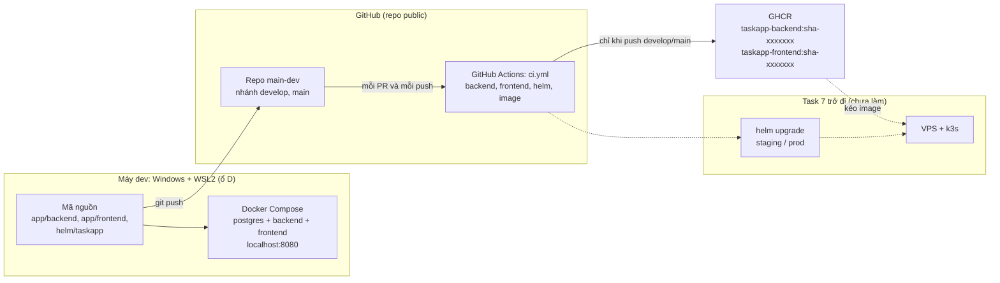

Hình 1. Phạm vi đã hoàn thành sau Task 6.

---

## 2. Kiến thức nền cần nắm

Phần này giải thích các khái niệm dùng xuyên suốt. Nếu đã biết có thể bỏ qua.

| Khái niệm | Giải thích ngắn | Trong đồ án |
|---|---|---|
| Git, nhánh (branch) | Git lưu lịch sử thay đổi mã. Nhánh là một dòng phát triển riêng | `develop` để tích hợp, sau này triển khai lên staging. `main` để phát hành, sau này lên prod |
| Pull request (PR) | Yêu cầu gộp một nhánh vào nhánh khác, kèm kiểm tra tự động | PR #1 dùng để chứng minh CI báo đỏ khi có lỗi |
| API | Giao diện để chương trình khác gọi tới. Ở đây là các đường dẫn HTTP như `GET /api/tasks` | Backend FastAPI |
| Kiểm thử đơn vị, TDD | Viết test tự động. TDD (Test Driven Development) là viết test trước, chạy cho thấy fail, rồi mới viết mã cho test pass | Backend và frontend |
| Lint | Công cụ đọc mã để bắt lỗi kiểu dáng, lỗi tiềm ẩn mà không cần chạy | ruff (Python), ESLint (TypeScript) |
| Migration | Script thay đổi cấu trúc database theo từng phiên bản, chạy tuần tự | Alembic, 4 bản `0001` đến `0004` |
| Container, image | Image là gói chứa chương trình cùng mọi thứ nó cần. Container là image đang chạy, cô lập với máy chủ | Image backend, frontend, postgres |
| Registry | Kho chứa image | GHCR (GitHub Container Registry) |
| Docker Compose | Chạy nhiều container cùng lúc theo một file mô tả | `docker-compose.yml` |
| CI | Tích hợp liên tục: mỗi lần đẩy mã, máy tự build và test | `.github/workflows/ci.yml` |
| Kubernetes, k3s | Hệ thống điều phối container trên nhiều máy, tự khởi động lại khi lỗi. k3s là bản Kubernetes gọn nhẹ | Task 8 sẽ cài k3s lên VPS |
| Helm, chart | Helm là trình quản lý gói cho Kubernetes. Chart là bộ khuôn (template) sinh ra các file cấu hình Kubernetes | `helm/taskapp` |
| Ingress | Cổng vào HTTP/HTTPS của cụm Kubernetes, chia request theo đường dẫn | `/api` vào backend, `/` vào frontend |
| Probe | Kubernetes định kỳ hỏi container "còn sống không", "sẵn sàng nhận request chưa" | `/api/healthz`, `/api/readyz` |
| Secret | Dữ liệu nhạy cảm (mật khẩu) lưu riêng, không ghi vào mã | Mật khẩu DB, Basic Auth |

---

## 3. Task 1: Repo và môi trường làm việc

### 3.1. Mục tiêu

Có một repo GitHub với cấu trúc thư mục chuẩn và đủ công cụ trên máy để làm các task sau.

### 3.2. Vì sao dùng WSL2

Ansible (Task 7) chỉ chạy trên Linux. WSL2 cho phép chạy Ubuntu thật bên trong Windows. Vì vậy mọi lệnh Ansible, Terraform, kubectl, helm, pytest, npm đều chạy trong Ubuntu-24.04 của WSL, còn Windows chỉ dùng cho trình soạn thảo và Docker Desktop.

Mã nguồn chỉ có một bản, nằm ở `D:\ĐỒ ÁN II\kiro 1`. Từ WSL, thư mục này được nhìn thấy ở `/mnt/d/ĐỒ ÁN II/kiro 1`. Sửa file ở Windows thì WSL thấy ngay, không có bước đồng bộ.

### 3.3. Công cụ đã cài

Script `scripts/setup-wsl-tools.sh` cài các công cụ vào `~/.local/bin` trong WSL:

| Công cụ | Phiên bản | Dùng ở |
|---|---|---|
| Terraform | 1.16.6 | Task 9 |
| kubectl | v1.36.5 | Task 8 trở đi |
| Helm | v4.3.1 | Task 6, 10 |
| tflint | v0.64.0 | Task 9 |
| kubeconform | v0.8.0 | Task 6 |
| Node.js | v24.22.0 (LTS) | Task 3 |
| ansible, ansible-lint | 14.5.0, 26.10.1 | Task 7 |
| Trivy | 0.76.0 | Task 5 (quét image trên máy) |
| actionlint | 1.7.12 | Task 5 (kiểm tra file workflow) |

Cách script hoạt động, theo thứ tự:

1. Cài các gói hệ thống cần sudo (pipx, unzip) bằng apt.
2. Với mỗi công cụ: nếu đã có đúng phiên bản thì bỏ qua. Nếu chưa có thì tải bản chính thức về, tải kèm file checksum SHA-256 do nhà phát hành công bố, so sánh hai giá trị. Khớp mới cài, lệch thì dừng.
3. Cài Ansible bằng pipx (mỗi công cụ Python một môi trường riêng, không xung đột).
4. Thêm `~/.local/bin` lên đầu `PATH`, để bản Linux luôn được ưu tiên hơn bản Windows mà WSL tự gắn vào.

Kiểm tra checksum chống trường hợp file tải về bị sửa đổi hoặc hỏng. Việc bỏ qua công cụ đã cài đúng phiên bản giúp script chạy lại bao nhiêu lần cũng an toàn (tính lũy đẳng).

### 3.4. Cấu trúc repo và các file cấu hình chung

```
app/backend      API FastAPI
app/frontend     Giao diện React
helm/taskapp     Helm chart
infra/ansible    (Task 7, 8, 10)
infra/terraform  (Task 9, 12)
scripts          setup-wsl-tools.sh, smoke-test.sh, helm-check.sh
.github/workflows ci.yml
docs             tài liệu
```

- `.gitignore`: loại khỏi Git các file sinh ra (node_modules, venv, cache) và file nhạy cảm (`.env`, `*.tfstate`, `terraform.tfvars`, kubeconfig, inventory chứa IP thật, file vault đã giải mã).
- `.gitattributes`: ép mọi file văn bản dùng ký tự xuống dòng kiểu Linux (LF). Script sửa trên Windows thường bị đổi sang CRLF, khi chạy trong Linux sẽ báo lỗi khó hiểu. File này chặn lỗi đó từ gốc.

### 3.5. Nhánh

- `main`: bản phát hành, sau này triển khai lên prod.
- `develop`: bản tích hợp hằng ngày, sau này triển khai lên staging.

Mọi việc từ Task 2 đến Task 6 được commit lên `develop`.

---

## 4. Task 2: Backend FastAPI

### 4.1. Công nghệ

| Thành phần | Vai trò |
|---|---|
| FastAPI 0.143.2 | Framework web Python, tự sinh tài liệu API tại `/api/docs` |
| Uvicorn 0.54.0 | Máy chủ chạy ứng dụng FastAPI |
| SQLAlchemy 2.1.4 | Thư viện làm việc với database bằng đối tượng Python (ORM) |
| psycopg 3.3.6 | Driver kết nối PostgreSQL |
| Alembic 1.20.0 | Quản lý migration |
| pydantic 2.14.1, pydantic-settings 2.16.0 | Kiểm tra dữ liệu vào, đọc cấu hình từ biến môi trường |
| prometheus-fastapi-instrumentator 8.1.0 | Xuất số đo tại `/metrics` cho Prometheus (Task 12) |
| pytest, pytest-cov, ruff | Test, đo độ phủ mã, lint |

Mọi phiên bản được ghi cố định trong `requirements.txt` và `requirements-dev.txt` để lần cài nào cũng ra cùng kết quả.

### 4.2. Cấu trúc mã

```
app/backend/
  app/
    main.py          tạo ứng dụng, gắn các router, bật /metrics
    config.py        đọc DATABASE_URL từ biến môi trường
    db.py            kết nối database, cấp session cho mỗi request
    models.py        bảng database (Project, Label, Task, task_labels)
    schemas.py       định dạng dữ liệu vào/ra và luật kiểm tra
    routers/
      health.py      /api/healthz, /api/readyz
      projects.py    /api/projects
      labels.py      /api/labels
      tasks.py       /api/tasks
  alembic/versions/  0001 đến 0004
  tests/             125 test
```

Mỗi lớp có một việc: router nhận request và trả response, schema kiểm tra dữ liệu, model mô tả bảng, db quản lý kết nối. Tách như vậy giúp test và sửa từng phần độc lập.

### 4.3. Luồng xử lý một request

Hình 2 là ví dụ khi giao diện tạo một công việc mới.

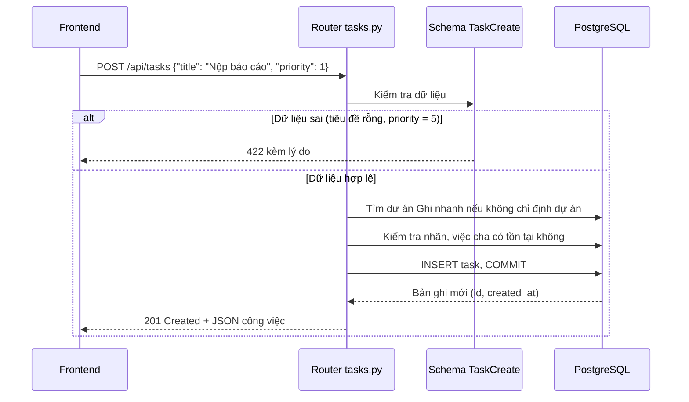

Hình 2. Luồng tạo công việc.

### 4.4. Các endpoint

| Endpoint | Ý nghĩa |
|---|---|
| `GET /api/healthz` | Liveness: tiến trình còn sống. Không đụng tới database, nên database chậm cũng không làm Kubernetes khởi động lại backend |
| `GET /api/readyz` | Readiness: kết nối được database. Lỗi thì trả 503 để Kubernetes tạm ngừng gửi request vào |
| `GET /metrics` | Số đo cho Prometheus: số request, thời gian xử lý. Không đếm các request probe để biểu đồ không bị nhiễu |
| `GET, POST /api/projects`; `PATCH, DELETE /api/projects/{id}` | Dự án. Dự án Ghi nhanh không sửa hay xóa được (409) |
| `GET, POST /api/labels`; `PATCH, DELETE /api/labels/{id}` | Nhãn, tên không trùng (không phân biệt hoa thường) |
| `GET /api/tasks` | Danh sách, lọc theo dự án, nhãn, trạng thái, khoảng ngày, tìm kiếm không dấu, công việc con, phân trang |
| `POST /api/tasks`; `GET, PATCH, DELETE /api/tasks/{id}` | Tạo, đọc, sửa, xóa một công việc |
| `GET /api/docs` | Tài liệu API tương tác (Swagger UI) |

Mã trạng thái HTTP được dùng đúng chuẩn: 201 khi tạo, 204 khi xóa, 404 khi không tìm thấy, 409 khi xung đột, 422 khi dữ liệu sai.

### 4.5. Mô hình dữ liệu

Hình 3 là cấu trúc database sau migration `0004`.

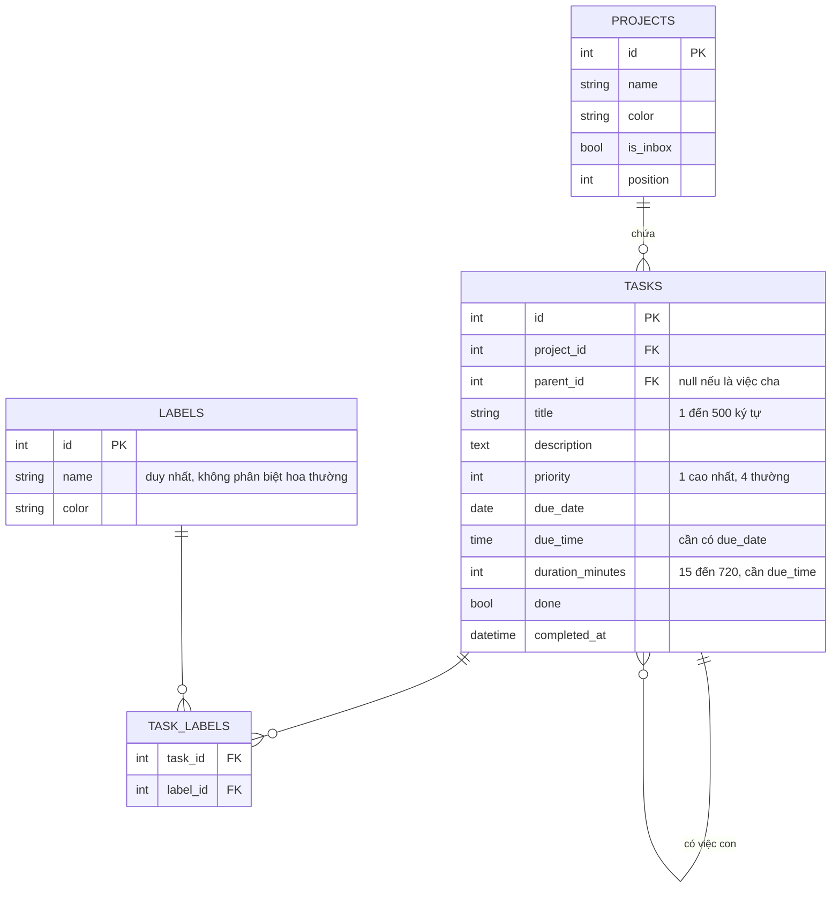

Hình 3. Mô hình dữ liệu.

Một số luật được kiểm tra ở cả hai nơi: trong mã Python (để trả lỗi rõ ràng) và trong database bằng ràng buộc CHECK (để không có dữ liệu sai, kể cả khi ai đó ghi thẳng vào database). Ví dụ: có giờ thì phải có ngày, có thời lượng thì phải có giờ.

### 4.6. Migration

Database thay đổi qua 4 bước, mỗi bước là một file trong `alembic/versions/`:

| Bản | Nội dung |
|---|---|
| `0001` | Bảng `tasks` ban đầu: id, title, done, created_at |
| `0002` | Thêm `projects`, `labels`, `task_labels`; thêm cột ưu tiên, ngày, mô tả, việc con. Tạo dự án mặc định và chuyển các công việc cũ vào đó. Bật extension `unaccent` để tìm "hoc" ra "Học" |
| `0003` | Đổi tên dự án mặc định thành "Ghi nhanh" |
| `0004` | Thêm `due_time`, `duration_minutes` cho Lịch tuần |

Mỗi bản có cả `upgrade` (nâng lên) và `downgrade` (hạ xuống). Lệnh `alembic check` được chạy để xác nhận mô hình trong Python khớp hoàn toàn với database.

### 4.7. Cách viết test (TDD)

Quy trình lặp lại cho từng tính năng:

1. Viết test mô tả hành vi mong muốn.
2. Chạy test, thấy fail (vì chưa có mã). Bước này chứng minh test thật sự kiểm tra được điều gì đó.
3. Viết mã cho đến khi test pass.
4. Chạy lint, chạy toàn bộ test.

Test chạy trên PostgreSQL thật (container `postgres:18.6-alpine`), không dùng database giả, vì một số tính năng chỉ PostgreSQL có (tìm kiếm không dấu, ràng buộc CHECK, khóa advisory). Trong CI, PostgreSQL chạy dưới dạng service container của GitHub Actions.

Kết quả hiện tại: 125 test pass, độ phủ mã 99,44% (yêu cầu tối thiểu 80%).

Một test đáng chú ý là `test_migration_lock.py` (thêm ở Task 6): chạy 3 tiến trình `alembic upgrade head` cùng lúc để mô phỏng 3 backend khởi động đồng thời. Khi tạm bỏ khóa, test fail 3 trên 3 lần chạy. Khi có khóa, test pass. Đây là cách xác nhận test bắt được lỗi thật chứ không pass một cách vô nghĩa.

---

## 5. Task 3 và 3B: Frontend React

### 5.1. Diễn biến

Task 3 ban đầu làm một danh sách công việc đơn giản. Sau đó theo yêu cầu, ứng dụng được mở rộng thành Task 3B, tham khảo Todoist. Toàn bộ phân tích nằm ở `docs/app-feature-plan.md`, mockup ở `docs/design/`. Các quyết định đã chốt với người dùng: phạm vi P0, đăng nhập bằng Basic Auth ở Ingress, thêm 2 thư viện react-router và react-query, màu nhấn indigo. Sau đó bổ sung đổi tên "Hộp thư đến" thành "Ghi nhanh" và màn Lịch tuần.

### 5.2. Công nghệ

| Thành phần | Vai trò |
|---|---|
| React 19.3.1 + TypeScript 6.0.3 | Xây giao diện theo component, có kiểu dữ liệu |
| Vite 8.3.4 | Build và máy chủ dev. Khi dev, Vite chuyển `/api` sang `localhost:8000` |
| react-router 8.4.0 | Mỗi màn có URL riêng: `/today`, `/week`, `/project/3` |
| @tanstack/react-query 5.104.3 | Lấy dữ liệu từ API, lưu cache, cập nhật lạc quan |
| Vitest + Testing Library | Test giao diện như người dùng thật thao tác |
| ESLint 10 + plugin accessibility | Lint, bắt lỗi truy cập (thiếu nhãn, thiếu tên nút) |

Giao diện không dùng thư viện UI có sẵn. Màu sắc, khoảng cách, cỡ chữ được khai báo một lần dưới dạng biến CSS (design tokens) trong `src/styles/tokens.css`, mỗi component có file CSS riêng (CSS Modules). Lý do: ít thư viện thì image nhỏ hơn, ít lỗ hổng phải quét hơn.

### 5.3. Các màn hình

| Màn | Đường dẫn | Nội dung |
|---|---|---|
| Ghi nhanh | `/inbox` | Nơi rơi vào của việc chưa xếp dự án |
| Hôm nay | `/today` | Việc quá hạn (nút Lên lịch lại) và việc hôm nay |
| Sắp tới | `/upcoming` | 7 ngày tới, nhóm theo ngày |
| Lịch tuần | `/week` | Dạng thời khóa biểu: 7 cột ngày, hàng Cả ngày, khung giờ |
| Dự án, Nhãn | `/project/:id`, `/label/:id` | Việc theo dự án hoặc nhãn |
| Đã hoàn thành | `/completed` | Nhóm theo ngày hoàn thành |
| Tìm kiếm | `/search` | Tìm không cần dấu |

Phím tắt: `q` thêm nhanh, `/` tìm kiếm, `g` rồi `i`, `t`, `u`, `w` để chuyển màn, `?` xem bảng phím tắt.

### 5.4. Cách dữ liệu đi qua frontend

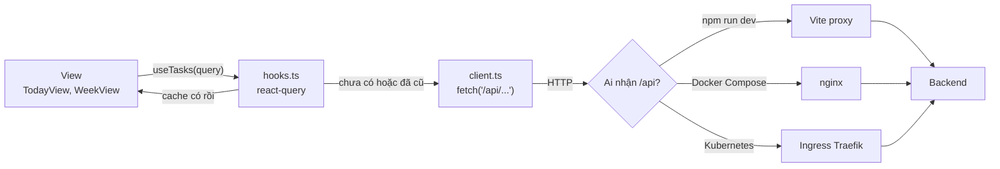

Hình 4. Luồng dữ liệu ở frontend.

Frontend luôn gọi đường dẫn tương đối `/api/...`. Tùy môi trường mà một thành phần khác chuyển tiếp request tới backend. Nhờ vậy cùng một bản build chạy được ở cả ba nơi, không cần cấu hình địa chỉ backend và không cần CORS.

### 5.5. Cập nhật lạc quan và Hoàn tác

Khi tick hoàn thành, giao diện đổi ngay, không chờ máy chủ trả lời. Hình 5 mô tả cơ chế.

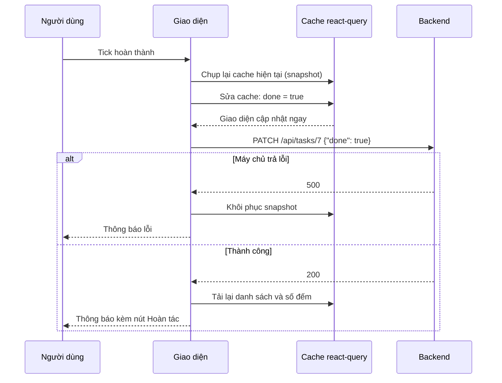

Hình 5. Cập nhật lạc quan.

Nút Hoàn tác chỉ đơn giản gửi thêm một PATCH `done: false`.

### 5.6. Thêm nhanh bằng câu tự nhiên

File `src/lib/quickAdd.ts` là một hàm thuần: nhận chuỗi người dùng gõ, trả về tiêu đề và các thuộc tính nhận diện được. Ví dụ "Họp nhóm thứ 2 3h chiều trong 90p p2 @khẩn" cho ra:

| Phần | Kết quả |
|---|---|
| Tiêu đề | Họp nhóm |
| Ngày | Thứ Hai gần nhất |
| Giờ | 15:00 |
| Thời lượng | 90 phút |
| Ưu tiên | P2 |
| Nhãn | khẩn |

Các bước hàm thực hiện:

```mermaid
flowchart TD
  A["Chuỗi người dùng gõ"] --> B["Tách thành từng từ, nhớ vị trí"]
  B --> C{"Lần lượt từng từ"}
  C --> D["Cụm ngày: hôm nay, mai, thứ 6,<br/>cuối tuần, 20/10, 2026-10-20"]
  C --> E["Thời lượng: trong 2 tiếng, trong 90p"]
  C --> F["Giờ: 9h, 9h30, 14:30, lúc 3h chiều, 9am"]
  C --> G["Ưu tiên: p1 đến p4"]
  C --> H["Dự án: dấu thăng + tên, so khớp không dấu"]
  C --> I["Nhãn: @tên, chưa có thì đánh dấu tạo mới"]
  D & E & F & G & H & I --> J["Ghi token: loại, vị trí, nội dung"]
  J --> K["Các từ không thuộc token nào ghép thành tiêu đề"]
  K --> L["Chỉ có giờ mà không có ngày:<br/>hôm nay, hoặc ngày mai nếu giờ đã qua"]
```

Hình 6. Bộ phân tích thêm nhanh.

Vị trí của token được giao diện dùng để tô màu đúng chữ trong ô nhập (một lớp chữ hiển thị nằm dưới ô nhập trong suốt). Mỗi phần nhận diện hiện thành chip có nút ×. Bấm × thì phần đó được đưa vào danh sách bỏ qua và trở lại thành chữ của tiêu đề. Cơ chế này xử lý các câu nhập nhằng như "Họp với Mai" (Mai là tên người).

Bộ phân tích có 87 case test dạng bảng (`src/lib/quickAdd.test.ts`), gồm cả tiếng Việt có dấu, không dấu, tiếng Anh và các trường hợp không được nhận nhầm ("mãi", "maika", "Thu hoạch").

### 5.7. Lịch tuần

Hai bài toán chính:

1. Đặt khối đúng vị trí. Mỗi giờ cao 48 px, nên việc bắt đầu lúc 9:00 có tọa độ `top = 9 × 48 = 432 px`, việc dài 2 giờ cao `96 px`. Test kiểm tra đúng các con số này.
2. Xử lý việc trùng giờ. Hàm `layoutDay` trong `src/lib/time.ts` gom các việc chồng nhau thành nhóm, mỗi việc nhận một làn trống đầu tiên. Khi hiển thị, mỗi khối rộng hơn phần chia của nó 1,7 lần và khối sau đè lên khối trước, giống Google Calendar, để tiêu đề còn đọc được.

Trên mobile chỉ hiện một ngày, có hàng chọn ngày phía trên.

### 5.8. Accessibility

- Mọi ô nhập có nhãn, mọi nút có tên đọc được, kể cả nút chỉ có icon.
- Ô tick hoàn thành là `role="checkbox"` có `aria-checked`, đi được bằng Tab và Space.
- Hộp thoại dùng thẻ `<dialog>` của trình duyệt: tự giữ focus bên trong, Esc để đóng.
- Màu chữ được chọn để đạt độ tương phản tối thiểu 4,5:1 (chuẩn WCAG AA), cả trên nền trắng lẫn nền khi rê chuột. Mức này dựa trên phép tính tương phản màu, chưa được kiểm định bằng công cụ hỗ trợ tiếp cận thật.

### 5.9. Test frontend

151 test Vitest. Phần lớn là test tích hợp: render cả ứng dụng với một API giả trong bộ nhớ (`src/test/fakeApi.ts`) mô phỏng đúng luật của backend thật (lọc, sắp xếp, ràng buộc ngày giờ). Test thao tác như người dùng: gõ phím, bấm nút, rồi kiểm tra dữ liệu trong API giả và nội dung trên màn hình.

Ngoài test tự động, giao diện được chụp lại bằng Edge chế độ không màn hình (headless) ở các chế độ sáng, tối, desktop và mobile để xem bằng mắt. Qua ảnh chụp đã phát hiện và sửa lỗi icon tìm kiếm đè lên chữ (do thứ tự nạp CSS).

---

## 6. Task 4: Docker và Docker Compose

### 6.1. Vì sao đóng gói bằng Docker

Máy dev, máy CI và máy chủ có thể khác nhau về hệ điều hành, phiên bản Python, Node. Image đóng gói ứng dụng cùng mọi thứ nó cần, nên chạy ở đâu cũng giống nhau. Image còn là đơn vị mà Kubernetes dùng để triển khai.

### 6.2. Build nhiều giai đoạn (multi-stage)

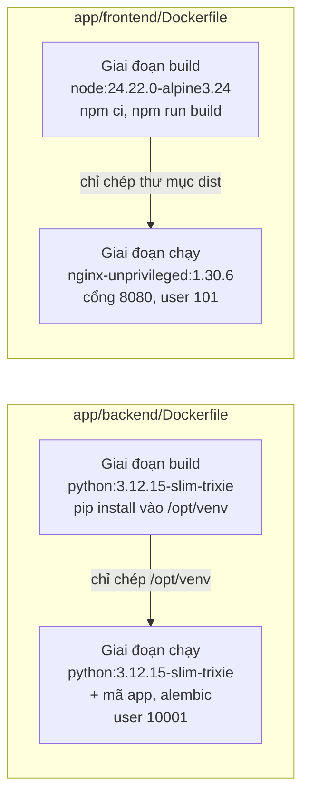

Hình 7. Hai Dockerfile.

Giai đoạn build có đủ công cụ biên dịch, nhưng image cuối chỉ giữ kết quả. Nhờ vậy image frontend chỉ 91 MB (không có Node, không có mã nguồn), image backend 324 MB.

Entrypoint của backend (`docker-entrypoint.sh`) chạy `alembic upgrade head` trước, rồi mới khởi động uvicorn. Database luôn được nâng cấp trước khi ứng dụng nhận request. Có thể tắt bằng biến `RUN_MIGRATIONS=false`.

### 6.3. Vai trò của nginx

nginx trong image frontend làm 3 việc:

1. Phục vụ file tĩnh (HTML, JS, CSS) của giao diện.
2. Chuyển hướng mọi đường dẫn giao diện (`/today`, `/week`) về `index.html` để React tự xử lý. Thiếu bước này thì tải lại trang `/week` sẽ ra lỗi 404.
3. Chuyển tiếp `/api` sang backend. Bước này chỉ dùng khi chạy bằng Compose. Trên Kubernetes, Ingress đã chia `/api` về backend trước khi request tới nginx.

Thêm vào đó: header bảo mật (chống nhúng trang vào iframe, chính sách nội dung CSP chỉ cho chạy script từ chính trang), nén gzip, cache 1 năm cho file trong `/assets/` (tên file có mã băm, đổi nội dung là đổi tên), không cache `index.html` để bản mới hiện ra ngay.

### 6.4. Docker Compose

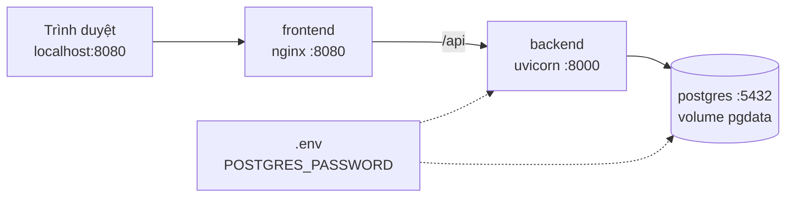

Hình 8. Ba service trong Docker Compose. Chỉ cổng 8080 được mở ra máy host.

Thứ tự khởi động được điều khiển bằng healthcheck:

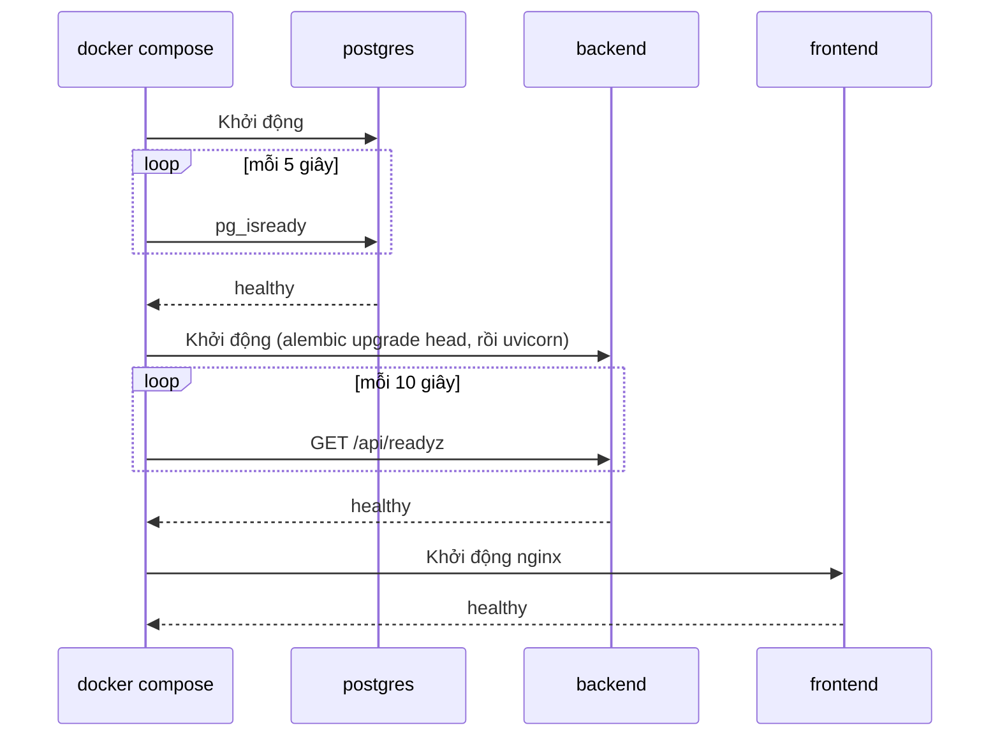

Hình 9. Thứ tự khởi động.

Container được làm cứng (hardening):

| Biện pháp | Ý nghĩa |
|---|---|
| Chạy user không phải root | Nếu ứng dụng bị khai thác, kẻ tấn công không có quyền root trong container |
| `read_only: true` | Không ghi được vào filesystem của container, chỉ ghi được vào vùng tạm `/tmp` |
| `cap_drop: ALL` | Bỏ mọi quyền đặc biệt của Linux |
| `no-new-privileges` | Không leo thang quyền qua chương trình setuid |
| Postgres không mở cổng ra host | Chỉ backend nói chuyện được với database |
| Mật khẩu trong `.env` | `.env` nằm trong `.gitignore`, chỉ commit `.env.example` |

Lỗi đã gặp và cách sửa: lần chạy đầu frontend báo unhealthy. Nguyên nhân là filesystem chỉ đọc, nginx cần ghi file cấu hình vào `/etc/nginx/conf.d` nên được cấp vùng tạm (tmpfs), nhưng vùng tạm mặc định thuộc root, user nginx (UID 101) không ghi được. Không có file cấu hình thì nginx không mở cổng 8080. Sửa bằng cách đặt chủ sở hữu vùng tạm là UID 101.

### 6.5. Smoke test

`scripts/smoke-test.sh <địa chỉ>` kiểm tra nhanh một bản đang chạy, dùng được cho Compose bây giờ và cho staging, prod sau này:

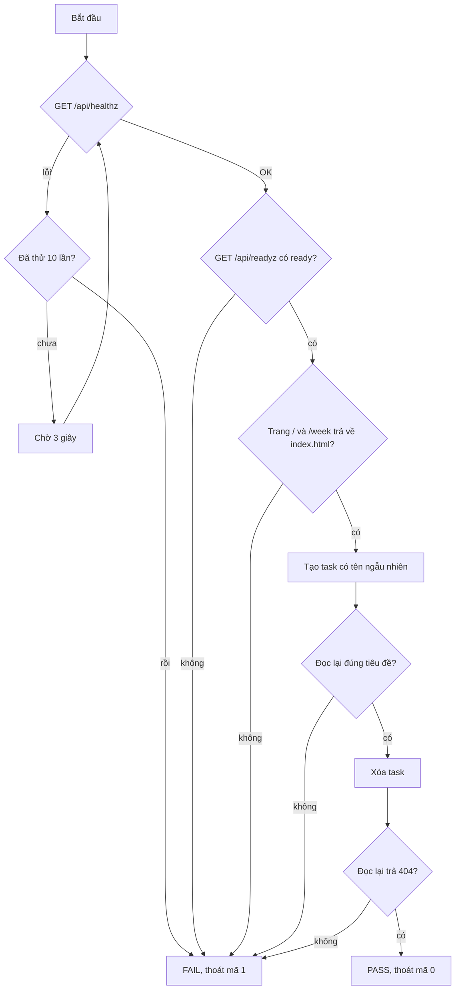

Hình 10. Các bước của smoke test.

Script dùng `set -euo pipefail`: bất kỳ lệnh nào lỗi đều dừng script với mã thoát khác 0, nên pipeline sau này biết được là thất bại. Biến `SMOKE_AUTH=user:pass` để đi qua Basic Auth ở staging, prod. Đã thử với địa chỉ sai, script báo lỗi đúng như mong đợi.

Kết quả Task 4: cả 3 service healthy, smoke test PASS, dữ liệu còn nguyên sau khi khởi động lại.

---

## 7. Task 5: Pipeline CI trên GitHub Actions

### 7.1. Khái niệm

GitHub Actions đọc file YAML trong `.github/workflows/`. Một workflow gồm nhiều job, mỗi job gồm nhiều bước (step) chạy trên một máy ảo (runner) do GitHub cấp. Workflow của đồ án là `.github/workflows/ci.yml`.

### 7.2. Khi nào CI chạy

| Sự kiện | Chạy job nào | Đẩy image? |
|---|---|---|
| Mở hoặc cập nhật pull request | Tất cả | Không |
| Push lên `develop` hoặc `main` | Tất cả | Có |

Không đẩy image khi có PR là biện pháp an toàn: PR có thể đến từ người lạ (repo public), không được phép ghi vào registry.

`concurrency` đảm bảo mỗi nhánh hoặc PR chỉ có một lần chạy. Đẩy mã mới trong lúc CI đang chạy thì lần chạy cũ bị hủy, tiết kiệm thời gian.

### 7.3. Các job và thứ tự

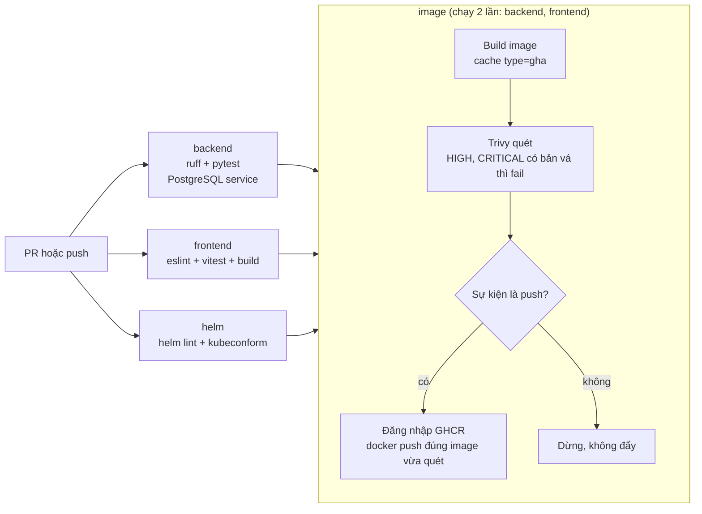

Hình 11. Các job trong `ci.yml`.

Ba job đầu chạy song song. Job image chỉ chạy khi cả ba pass: không đóng gói mã chưa qua kiểm tra.

### 7.4. Chi tiết từng job

Job backend:

1. Lấy mã nguồn (`actions/checkout`), không lưu token vào thư mục làm việc.
2. Cài Python 3.12, bật cache pip.
3. Khởi động PostgreSQL 18.6 dạng service container, chờ `pg_isready`.
4. `ruff check` và `ruff format --check`.
5. `pytest`, fail nếu độ phủ dưới 80%.

Job frontend:

1. Cài Node 24.22.0, bật cache npm.
2. `npm ci` (cài đúng theo `package-lock.json`).
3. `npm run lint`, `npm test -- --run`, `npm run build`.

Job helm (thêm ở Task 6): tải Helm và kubeconform bản chính thức, kiểm checksum, chạy `scripts/helm-check.sh` (xem mục 8.6).

Job image, mỗi thành phần một lần:

1. Tính tên image `ghcr.io/nhatminh0113/taskapp-<thành phần>` và tag `sha-<7 ký tự đầu của commit>`.
2. Build bằng Docker Buildx, nạp vào Docker của runner, dùng cache của GitHub Actions để lần sau nhanh hơn.
3. Trivy quét image: tìm lỗ hổng mức HIGH hoặc CRITICAL trong gói hệ điều hành và thư viện. Bỏ qua lỗ hổng chưa có bản vá (`ignore-unfixed`), vì không có cách sửa thì chặn build cũng vô ích.
4. Nếu là push: đăng nhập GHCR bằng `GITHUB_TOKEN` tạm thời của lần chạy, rồi `docker push` đúng image vừa quét. Image trên registry vì thế chính là image đã qua quét, không phải một bản build lại.

### 7.5. Bảo mật của pipeline

| Biện pháp | Lý do |
|---|---|
| `permissions: contents: read` mặc định | Token của workflow chỉ đọc được mã |
| Chỉ job image có `packages: write` | Quyền ghi registry nằm ở đúng một job |
| Push chỉ khi `github.event_name == 'push'` | PR không bao giờ ghi vào registry |
| Action chính thức pin theo tag cụ thể (`actions/checkout@v7.0.1`) | Không tự nhận bản mới không kiểm soát |
| Action bên thứ ba pin theo commit SHA (`aquasecurity/trivy-action@ed142fd...`) | Tag có thể bị kẻ xấu chuyển sang mã khác, SHA thì không đổi được |
| Mọi job chạy trên `ubuntu-latest` của GitHub | Self-hosted runner trên VPS (Task 10) không bao giờ chạy mã từ PR |
| Tag image theo commit, không dùng `latest` | Biết chính xác image nào ứng với mã nào, quay lui được |

### 7.6. Kiểm chứng

| Tiêu chí | Cách kiểm | Kết quả |
|---|---|---|
| PR có lỗi thì CI đỏ | Nhánh `demo/ci-red-green` cố ý đổi `/api/healthz` trả `"OK"` thay vì `"ok"`, mở PR #1 | Job backend fail ở bước pytest, job image bị bỏ qua |
| Sửa lại thì CI xanh | Revert lỗi trên cùng nhánh | Cả 4 job xanh, job image chỉ build và quét, không đẩy |
| Image có trên GHCR | Push lên `develop` | `taskapp-backend:sha-affc581`, `taskapp-frontend:sha-affc581` |
| Image public | Kéo image không đăng nhập | HTTP 200 |

PR #1 sau đó được đóng không gộp, nhánh demo đã xóa. Trước khi đẩy, workflow được kiểm tra bằng `actionlint` và image được quét Trivy trên máy với cùng cấu hình.

---

## 8. Task 6: Helm chart

### 8.1. Helm giải quyết vấn đề gì

Kubernetes cấu hình bằng file YAML. Staging và prod giống nhau đến 90%, chỉ khác tên miền, số bản sao, tài nguyên. Viết hai bộ YAML riêng thì dễ lệch nhau. Helm cho phép viết một bộ khuôn (template) có chỗ trống, rồi điền giá trị khác nhau cho từng môi trường.

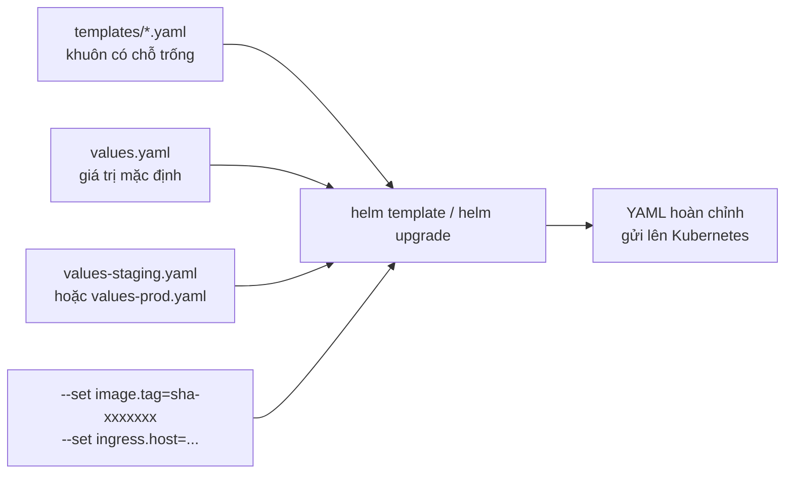

Hình 12. Cách Helm sinh cấu hình. Giá trị sau ghi đè giá trị trước.

### 8.2. Cấu trúc chart

```
helm/taskapp/
  Chart.yaml            tên, phiên bản chart, yêu cầu Kubernetes >= 1.30
  values.yaml           giá trị mặc định
  values-staging.yaml   1 bản sao, 1 Gi ổ đĩa
  values-prod.yaml      2 bản sao, nhiều tài nguyên hơn, 2 Gi ổ đĩa
  templates/
    _helpers.tpl        hàm dùng chung: tên, nhãn, image, securityContext
    backend.yaml        Deployment + Service backend
    frontend.yaml       Deployment + Service frontend
    postgres.yaml       StatefulSet + Service headless
    ingress.yaml        Ingress Traefik
    basic-auth.yaml     Middleware Basic Auth của Traefik
    servicemonitor.yaml cho Prometheus (Task 12, mặc định tắt)
    networkpolicy.yaml  tường lửa trong cụm (Task 13, mặc định tắt)
    NOTES.txt           hướng dẫn in ra sau khi cài
```

### 8.3. Các tài nguyên trong cụm và đường đi của request

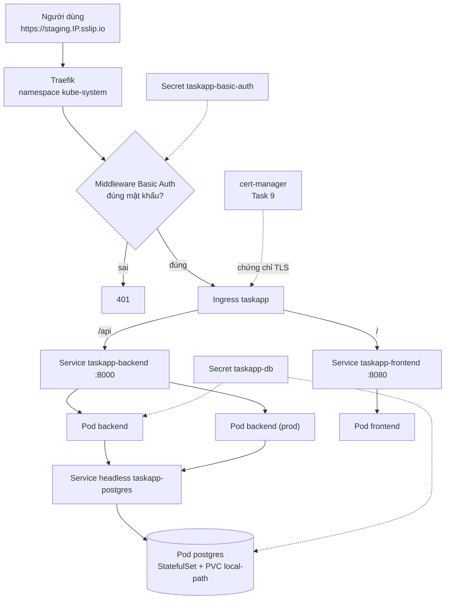

Hình 13. Tài nguyên Kubernetes do chart tạo ra (namespace staging hoặc prod).

Giải thích các loại tài nguyên:

| Tài nguyên | Vai trò |
|---|---|
| Deployment | Giữ đúng số bản sao của backend, frontend. Pod chết thì tạo lại. Khi cập nhật thì thay dần từng pod |
| StatefulSet | Dành cho thành phần có dữ liệu như postgres: tên pod cố định, ổ đĩa gắn chặt với pod |
| PVC (PersistentVolumeClaim) | Yêu cầu một ổ đĩa. `local-path` là loại có sẵn trong k3s, lưu trên ổ của VPS |
| Service | Địa chỉ ổn định để gọi tới một nhóm pod, dù pod thay đổi |
| Service headless | Service không có IP ảo, cho tên DNS trỏ thẳng tới pod postgres |
| Ingress | Quy tắc chia request theo tên miền và đường dẫn |
| Middleware | Tài nguyên riêng của Traefik, ở đây là kiểm tra Basic Auth trước khi vào app |

### 8.4. Probe và cập nhật không gián đoạn

| Probe | Backend | Ý nghĩa |
|---|---|---|
| startupProbe | `/api/healthz`, tối đa khoảng 2,5 phút | Cho thời gian chạy migration lúc khởi động. Trong thời gian này hai probe dưới chưa chạy |
| livenessProbe | `/api/healthz` | Lỗi 3 lần liên tiếp thì Kubernetes khởi động lại container |
| readinessProbe | `/api/readyz` | Lỗi thì pod bị gỡ khỏi Service, không nhận request, nhưng không bị khởi động lại |

Rolling update với `maxUnavailable: 0`, `maxSurge: 1`: Kubernetes tạo pod mới trước, chờ pod mới sẵn sàng (readiness pass) rồi mới tắt pod cũ. Người dùng không thấy gián đoạn. Ở Task 11, nếu pod mới không bao giờ sẵn sàng (ví dụ cố ý làm sai readiness probe), Helm với cờ rollback sẽ tự quay về bản cũ.

### 8.5. Bảo mật trong chart

Mọi pod chạy theo mức "restricted" của Pod Security Standards:

| Thiết lập | Ý nghĩa |
|---|---|
| `runAsNonRoot`, UID cố định (backend 10001, frontend 101, postgres 70) | Không chạy root |
| `readOnlyRootFilesystem: true` | Chỉ ghi được vào các vùng emptyDir khai báo riêng (`/tmp`, thư mục cấu hình nginx, socket postgres) |
| `capabilities: drop ALL`, `allowPrivilegeEscalation: false` | Không có quyền đặc biệt, không leo thang |
| `seccompProfile: RuntimeDefault` | Hạn chế các lời gọi hệ thống nguy hiểm |
| `automountServiceAccountToken: false` | Pod không có token để gọi API Kubernetes, vì app không cần |

Chart không chứa mật khẩu. Hai Secret `taskapp-db` và `taskapp-basic-auth` sẽ do pipeline tạo ở Task 10. Backend ghép `DATABASE_URL` từ Secret bằng cú pháp `$(DB_PASSWORD)`, vì vậy mật khẩu phải dùng ký tự an toàn trong URL (ví dụ chuỗi hex).

Chart còn có rào chắn: từ chối sinh cấu hình khi thiếu `image.tag`, khi tag là `latest`, hoặc khi thiếu `ingress.host`. Như vậy không thể triển khai nhầm một image không xác định.

Riêng postgres chạy với filesystem chỉ đọc là điều chưa được thử ở Task 4. Đã kiểm bằng Docker với đúng các ràng buộc của chart (UID 70, chỉ đọc, bỏ mọi quyền): khởi tạo database, ghi và đọc dữ liệu đều được.

### 8.6. Migration khi có nhiều bản sao

Prod có 2 backend khởi động cùng lúc, cả hai đều chạy `alembic upgrade head`. Nếu không xử lý, cả hai cùng tạo bảng và một trong hai sẽ lỗi. Giải pháp: trong `alembic/env.py`, trước khi chạy migration, mỗi tiến trình xin một khóa advisory của PostgreSQL.

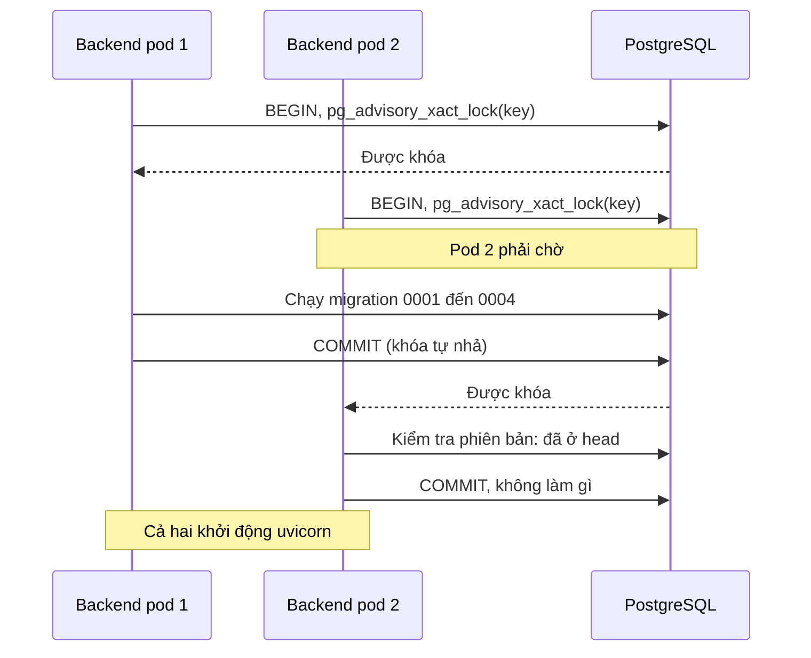

Hình 14. Khóa migration.

Phương án khác là dùng Helm hook (một Job chạy migration trước khi cập nhật). Phương án này không được chọn vì ở lần cài đầu tiên, Job chạy trước khi Secret và postgres tồn tại nên sẽ thất bại.

### 8.7. Kiểm tra chart

`scripts/helm-check.sh` chạy trên máy và trong CI:

1. `helm lint --strict` với values staging và prod.
2. `helm template ... | kubeconform -strict`: sinh YAML rồi đối chiếu với schema chính thức của Kubernetes 1.36.5. Tài nguyên riêng của Traefik (Middleware) và Prometheus (ServiceMonitor) được đối chiếu với schema từ kho CRDs-catalog, pin theo commit. Chạy hai lần: như khi triển khai, và khi bật thêm ServiceMonitor, NetworkPolicy.
3. Kiểm tra rào chắn: chart phải từ chối sinh cấu hình trong 3 trường hợp nêu ở mục 8.5.

Kết quả: 8 trên 8 tài nguyên hợp lệ ở cấu hình triển khai, 14 trên 14 khi bật đủ tính năng, không bỏ qua tài nguyên nào, 3 rào chắn đều hoạt động. CI chạy xanh cả 5 job.

Chart chưa được cài thử lên một cụm Kubernetes thật. Việc này làm ở Task 8 đến 10, khi có VPS.

---

## 9. Các quyết định quan trọng và lý do

Bảng đầy đủ ở mục 8 của `docs/MASTER_PLAN.md`. Dưới đây là những quyết định nên nắm để trả lời hội đồng.

| Quyết định | Lý do |
|---|---|
| Ghi cố định mọi phiên bản (thư viện, image, action, công cụ) | Build lặp lại được, nâng cấp có chủ đích, biết chính xác đang chạy gì |
| Kiểm tra checksum khi tải công cụ | Phát hiện file bị sửa đổi hoặc hỏng |
| Test backend trên PostgreSQL thật | Tính năng như tìm kiếm không dấu, ràng buộc CHECK, khóa advisory chỉ có ở PostgreSQL |
| Không dùng chart Bitnami cho PostgreSQL, tự viết StatefulSet với image chính thức | Bitnami đổi chính sách phân phối image từ 2025 |
| PostgreSQL 18: volume gắn vào `/var/lib/postgresql` | Từ bản 18, image chính thức đổi chỗ lưu dữ liệu |
| Swagger ở `/api/docs` | Ingress chỉ chuyển `/api` vào backend, đặt ở đây thì xem được trên staging, prod |
| Frontend gọi `/api` tương đối | Một bản build chạy được ở dev, Compose và Kubernetes, không cần CORS |
| Đăng nhập bằng Basic Auth ở Ingress, không làm đăng nhập trong app | App public trên Internet, cần chặn người lạ. Cách này không đụng mã app |
| Ngày hết hạn kiểu `date`, giờ kiểu `time` không múi giờ | Tránh lệch ngày giữa máy chủ và trình duyệt |
| ESLint 10 dùng `eslint-plugin-jsx-a11y-x` | Plugin gốc chưa hỗ trợ ESLint 10, ESLint 9 đã hết hỗ trợ |
| Helm 4: dùng `--rollback-on-failure` thay `--atomic` ở Task 10, 11 | Helm 4 đổi tên cờ, tên cũ sẽ bị bỏ |
| Image đẩy lên GHCR là đúng image Trivy đã quét | Không có khoảng hở giữa bản quét và bản triển khai |
| Khóa advisory cho migration thay vì Helm hook | Hook không chạy được ở lần cài đầu |
| Staging cũng dùng chứng chỉ `letsencrypt-prod` | Smoke test trong pipeline cần chứng chỉ được tin cậy |
| Dữ liệu phát sinh trên máy dev lưu ở ổ D | Ổ C gần đầy. Docker Desktop đã chuyển sang `D:\Docker` |

---

## 10. Những gì chưa làm, giới hạn hiện tại

- Chưa có máy chủ. Helm chart mới được kiểm tra tĩnh (lint, schema), chưa cài lên cụm thật.
- Chưa có CD: chưa tự triển khai lên staging, prod (Task 10, 11).
- Chưa có Ansible, Terraform, monitoring, NetworkPolicy đang bật (Task 7 đến 13).
- Trivy mới quét image. Quét cấu hình (Dockerfile, chart, Terraform) và đưa kết quả lên tab Security để ở Task 13.
- Ứng dụng không có tài khoản người dùng. Mọi người qua được Basic Auth đều thấy chung dữ liệu.
- Khi 3 việc trở lên trùng giờ, khối trên Lịch tuần hẹp và chữ bị cắt.
- Độ tương phản màu đạt mức AA theo tính toán, chưa kiểm định bằng công cụ hỗ trợ tiếp cận thật.
- GitHub thông báo `ubuntu-latest` chuyển sang Ubuntu 26 từ 19/10/2026. Nếu CI lỗi sau ngày này thì đổi sang `ubuntu-24.04`.
- Repo hiện nằm trên ổ D (`/mnt/d`). Trước Task 7 phải clone vào `~/projects` trong WSL vì Ansible không chạy ổn trên ổ Windows.

---

## 11. Câu hỏi hội đồng có thể hỏi

Gợi ý trả lời dựa trên những gì đã làm. Nên tự diễn đạt lại bằng lời của mình.

1. Vì sao cần CI? Mỗi lần đẩy mã, máy tự chạy lint, 125 test backend, 151 test frontend, kiểm tra chart, build và quét image. Lỗi bị phát hiện ngay ở PR, trước khi gộp. PR #1 là minh chứng: lỗi một chữ hoa ở `/api/healthz` làm CI đỏ.

2. Vì sao không đẩy image khi có PR? Repo public, ai cũng mở được PR. Nếu PR được ghi vào registry thì người lạ có thể đưa image độc hại lên. Workflow chỉ đăng nhập và đẩy khi sự kiện là push lên `develop` hoặc `main`, mà chỉ chủ repo mới push được.

3. Vì sao pin action bên thứ ba theo SHA? Tag như `v0.36.0` có thể bị chủ sở hữu (hoặc kẻ chiếm tài khoản) chuyển sang trỏ vào mã khác. Commit SHA là giá trị băm của nội dung, không đổi được.

4. Trivy quét gì, khi nào fail? Quét gói hệ điều hành và thư viện trong image. Fail khi có lỗ hổng mức HIGH hoặc CRITICAL đã có bản vá. Lỗ hổng chưa có bản vá được bỏ qua vì không có hành động khắc phục.

5. Tag `sha-xxxxxxx` có lợi gì so với `latest`? Mỗi image gắn với đúng một commit. Biết chính xác bản nào đang chạy, quay lui bằng cách triển khai lại tag cũ. `latest` thay đổi theo thời gian nên không truy vết được. Chart còn chặn hẳn tag `latest`.

6. healthz và readyz khác nhau thế nào? healthz chỉ trả lời "tiến trình còn sống", không đụng database. readyz kiểm tra database. Nếu dùng readyz cho liveness, database chậm sẽ làm Kubernetes khởi động lại backend liên tục mà không giải quyết được gì.

7. Multi-stage build để làm gì? Giai đoạn build có trình biên dịch, Node, mã nguồn. Image cuối chỉ giữ kết quả. Image frontend còn 91 MB, ít phần mềm hơn thì ít lỗ hổng hơn.

8. Vì sao container chạy user không phải root và filesystem chỉ đọc? Giảm thiệt hại khi ứng dụng bị khai thác: kẻ tấn công không có quyền root, không sửa được mã, không cài thêm công cụ.

9. Nhiều backend cùng chạy migration thì sao? Dùng `pg_advisory_xact_lock`. Tiến trình đầu giữ khóa và chạy migration, tiến trình sau chờ rồi thấy đã ở bản mới nhất nên không làm gì. Có test chạy 3 tiến trình song song: bỏ khóa thì fail 3 trên 3 lần.

10. Mật khẩu được giữ ở đâu? Không có trong repo. Máy dev dùng `.env` (gitignore). Kubernetes dùng Secret do pipeline tạo từ GitHub Environment secrets (Task 10). Chart chỉ tham chiếu tên Secret.

11. Vì sao dùng Helm thay vì viết YAML trực tiếp? Staging và prod dùng chung một bộ khuôn, chỉ khác file values. Không có hai bộ YAML có thể lệch nhau. Helm còn lưu lịch sử phát hành để quay lui.

12. Làm sao biết chart đúng khi chưa có cụm? `helm lint`, và kubeconform đối chiếu YAML sinh ra với schema chính thức của Kubernetes 1.36.5 cùng schema của Traefik, Prometheus. Đây là kiểm tra tĩnh. Kiểm tra trên cụm thật làm ở Task 8 đến 10.

13. TDD là gì, đã áp dụng thế nào? Viết test trước, chạy thấy fail, rồi mới viết mã. Ví dụ phần giờ và thời lượng: 17 test được viết trước, chạy thấy 11 fail, sau đó mới thêm migration và mã để chúng pass.

14. Vì sao test trên PostgreSQL thật? SQLite hoặc database giả không có `unaccent`, ràng buộc CHECK giống hệt, khóa advisory. Test trên database khác với thực tế có thể pass nhưng bản thật vẫn lỗi.

---

## 12. Tự kiểm chứng lại bằng lệnh

Chạy trong terminal Ubuntu-24.04, tại thư mục repo (`cd "/mnt/d/ĐỒ ÁN II/kiro 1"`). Docker Desktop phải đang chạy.

Backend:

```bash
docker start taskapp-test-db          # PostgreSQL cho test, cổng 5433
cd app/backend
source ~/.venvs/taskapp-backend/bin/activate
ruff check . && ruff format --check .
pytest                                # 125 test, độ phủ >= 80%
cd ../..
```

Frontend:

```bash
cd app/frontend
npm run lint
npm test -- --run                     # 151 test
npm run build
cd ../..
```

Cả hệ thống bằng Docker:

```bash
docker compose up -d --build
docker compose ps                     # 3 service healthy
scripts/smoke-test.sh http://localhost:8080
docker compose down
```

Helm chart:

```bash
scripts/helm-check.sh
```

Quét image giống CI:

```bash
trivy image --severity CRITICAL,HIGH --ignore-unfixed taskapp-backend:local
```

Kết quả CI trên GitHub: tab Actions của repo, hoặc các lần chạy đã dẫn trong tài liệu này:

- CI lần đầu trên `develop`: <https://github.com/nhatminh0113/main-dev/actions/runs/38915545280>
- PR #1 đỏ: <https://github.com/nhatminh0113/main-dev/actions/runs/38968271992>
- PR #1 xanh sau khi sửa: <https://github.com/nhatminh0113/main-dev/actions/runs/38968628569>
- CI có job Helm: <https://github.com/nhatminh0113/main-dev/actions/runs/38973196050>
